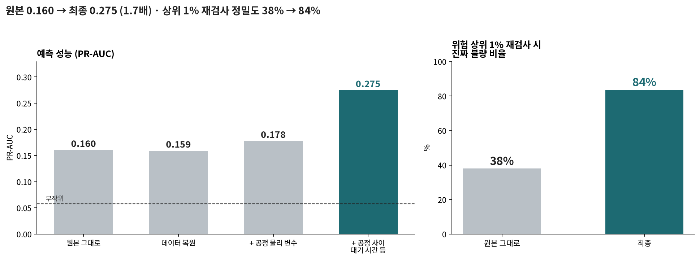
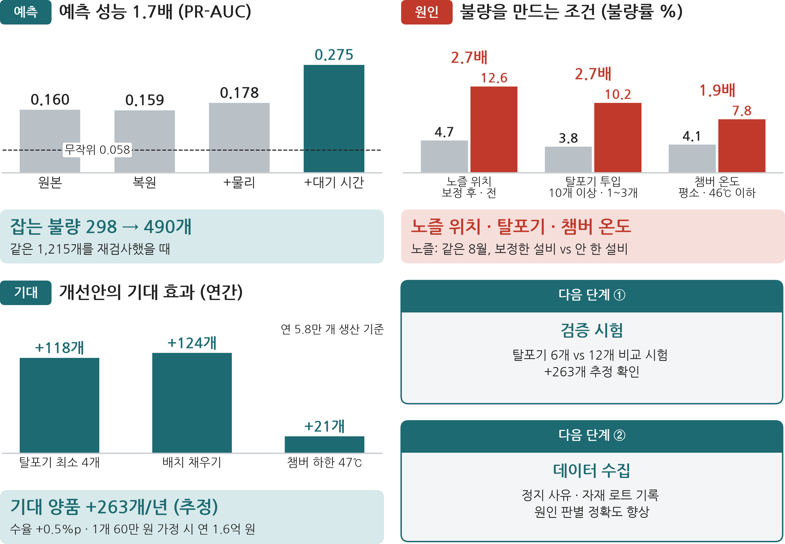
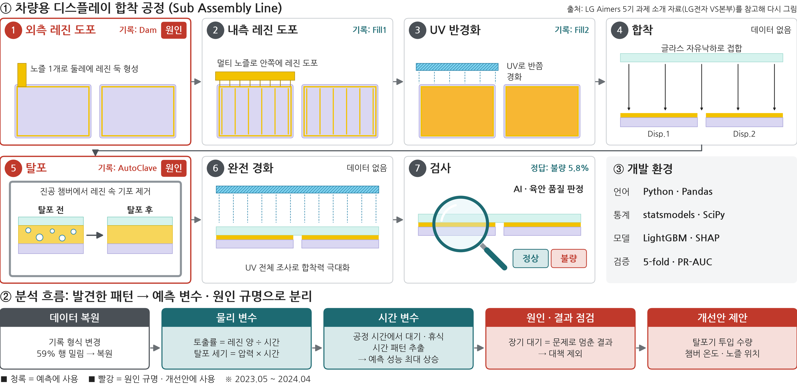
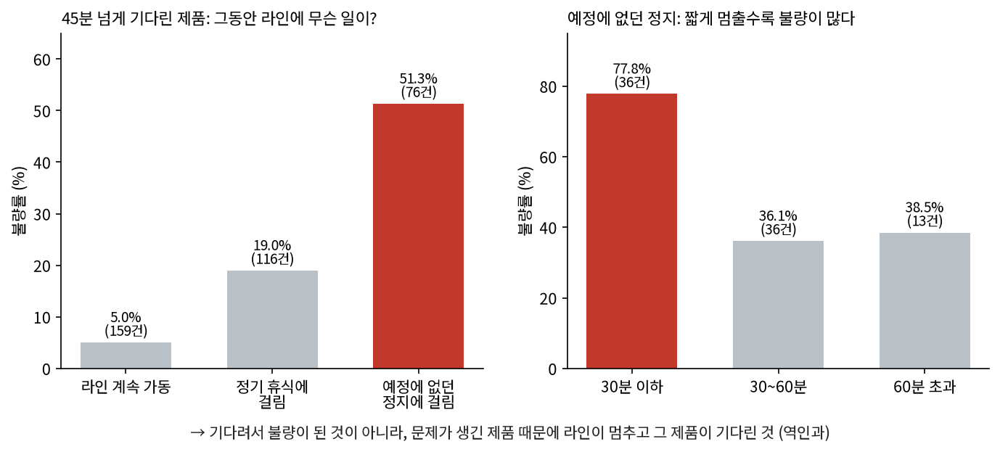
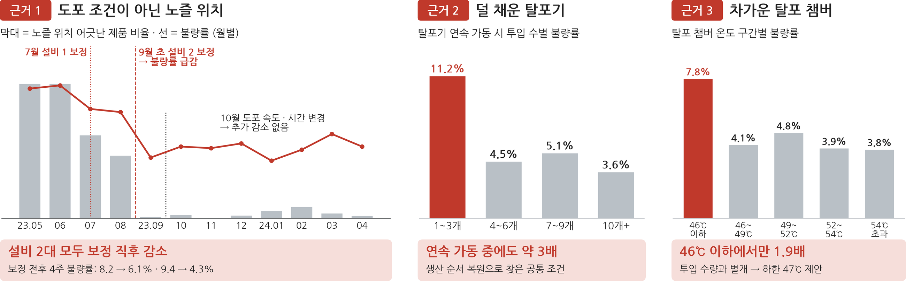
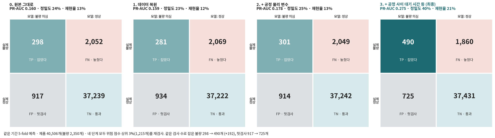
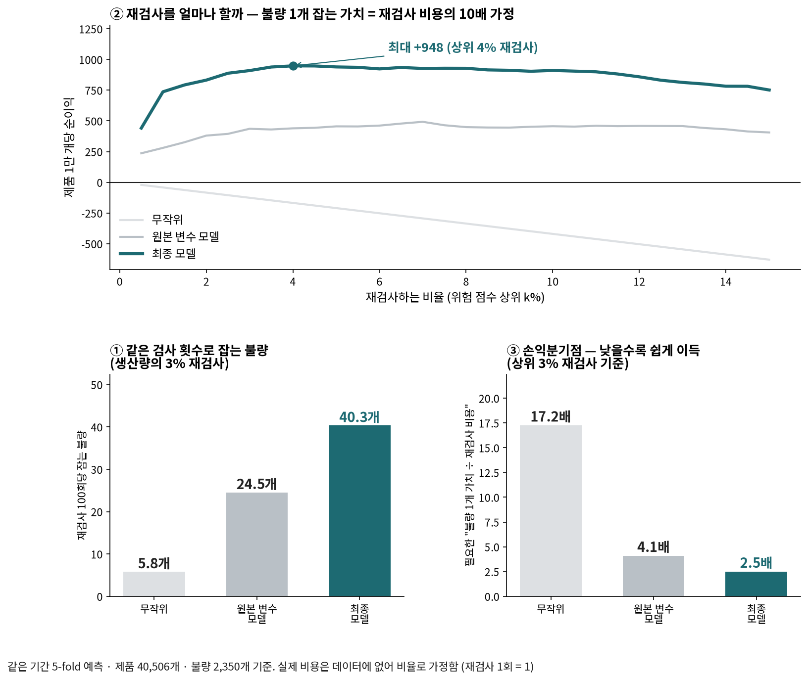

# LG전자 차량용 디스플레이 생산 라인(Sub Assembly) 데이터 기반 불량 예측 및 원인 분석

**공정 로그 4만 건 기반 예측 성능 1.7배 향상 · 불량 유발 공정 조건 3가지 규명** · 개선안 기대 양품 연 +263개 (추정, 시험 전)

LG Aimers 5기 본선(Data Intelligence) 데이터 · 제품 40,506개 · 공정 로그 468열 · 개인 프로젝트

> 대회 데이터는 재배포할 수 없어 이 저장소에 포함하지 않았다. 작업지시 번호와 모델 번호는 익명화했다(WO-01, 모델 A 등).

> 차량용 디스플레이 공장에서 **100개 중 6개가 불량**으로 버려진다. 공정 기록 4만 건을 분석해 불량과 이어지는 패턴을 찾았고, 그것을 두 갈래로 썼다. **① 불량일 제품을 미리 골라내는 모델**의 변수로, **② 불량을 만드는 공정 조건을 찾아 제안하는 개선안**으로.

| 골라내기 (예측) | 원인 찾기 |
|---|---|
| 예측 성능 **1.7배** (PR-AUC 0.160 → 0.275) | 과거 불량 감소는 도포 조건(레시피) 변경이 아니라 **Stage2 구간의 노즐 위치** |
| 위험 상위 1% 재검사 시 진짜 불량 **38% → 84%** | 기포 빼는 기계를 **덜 채우면 불량 2.7배** |
| 같은 1,215개 재검사로 잡는 불량 **298 → 490개** | 개선안으로 양품 **+263개/년** (추정) |



*원본 측정값에 공정 흐름으로 설계한 변수를 더할수록 성능이 올랐다*



*예측 성능 · 불량 조건 · 개선안의 기대 효과. 기대 효과는 관찰 데이터로 낸 추정이며 시험 전이다*

> 📄 **전체 보고서**: [프로젝트_불량예측과원인규명.pdf](reports/프로젝트_불량예측과원인규명.pdf) — 처음 보는 사람용, 읽는 법(지표 · 혼동행렬)부터 설명

---

## 1. 문제

차량용 디스플레이는 디스플레이 두 장 위에 커버 글라스 한 장을 투명 레진으로 붙여 만든다.



*공정 흐름은 LG Aimers 5기 과제 소개 자료(LG전자 VS본부)를 참고해 다시 그렸다. 빨간 칸이 원인을 찾은 공정이다*

| | ① 골라내기 (예측) | ② 원인 찾기 |
|---|---|---|
| 질문 | 이 제품은 불량일까? | 불량은 왜 생기고, 무엇을 고쳐야 하나? |
| 효과 | 같은 검사 비용으로 더 많은 불량을 잡는다 | 무엇을 고칠지 알 수 있다 (시험으로 확인 필요) |
| 필요한 것 | 불량을 잘 **맞히는** 변수 | 불량을 **만드는** 원인 (같이 움직이는 것과 구분) |

## 2. 분석 — 무엇을 발견했나

관계가 보이면 네 가지를 확인했다: **같은 달끼리 비교 · 다른 조건 고정 · 원인과 결과가 뒤바뀌지 않았나 · 라인·기간별로 나눠도 같은가.**

| # | 발견 | 예측에 쓰다 | 원인을 고치다 |
|---|---|---|---|
| 1 | 기록 형식이 바뀌어 **59% 행의 값이 한 칸씩 밀려** 있었다 → 복원 | ○ (바탕) | ○ (전제) |
| 2 | 둑 두께는 레진 양 ÷ 시간, 기포는 압력 × 시간이 정한다 → 물리 변수 32개 | ○ | – |
| 3 | **공정 사이에서 오래 걸린 제품이 불량** (2시간 넘게 걸린 103개 중 102개) → 대기 시간 변수 | ○ **가장 큰 상승** | – |
| 4 | 그런데 "오래 기다림"의 상당수는 **원인이 아니라 결과**였다 | ○ (흔적도 신호) | ✕ 대책에서 제외 |
| 5 | 과거 불량 감소는 도포 조건(레시피) 변경이 아니라 **Stage2 구간 노즐 위치** 보정이었다 | – | ○ |
| 6 | 기포 빼는 기계(탈포기)를 **덜 채우면 불량 2.7배** (1 ~ 3개 vs 10개 이상) | △ | ○ |
| 7 | 탈포 챔버 46℃ 이하면 불량 1.9배 | – | ○ |

### 발견 4 — 내 최고 결과를 의심했다


라인이 계속 돌았다면 오래 기다려도 불량률은 평소와 같았다(5%). 예정에 없던 정지에 걸린 제품만 51%가 불량이었고, **짧게 멈출수록** 불량이 많았다. "문제 발생 → 라인 정지 → 그 제품이 대기"다(순수한 대기의 위험도 일부 남는다). 그래서 대기 시간은 **예측엔 쓰고, 대책에선 뺐다.**

### 발견 5 — 도포 조건(레시피) 변경이 아니었다


불량률은 레시피를 바꾸기 **한 달 전**에 떨어졌다. 그때 바뀐 것은 둑 레진 토출량이 절반인 Stage2 구간의 노즐 위치 보정 하나뿐이었다. 설비 두 대가 서로 다른 시점에 보정했고, 두 번 모두 보정 직후 불량률이 떨어졌다(설비별 보정 전후 4주: 8.2 → 6.1%, 9.4 → 4.3%).

### 발견 6 — 덜 채운 탈포기
"아침 첫 제품"과 "휴식 직전 제품"의 공통점을 찾으려고 생산 카운터로 제품 순서를 복원했다. 공통점은 탈포기를 덜 채우고 돌린 것이었다. 기계가 식어서가 아니었다(가동 중 · 온도 고정 · 라인·기간별로도 동일).

## 3. 골라내기 — 예측에 쓰다

첫 변수 설계에서 만든 변수를 묶음별로 나눠, 원본부터 **같은 LightGBM · 같은 설정으로 하나씩 다시 쌓았다.** 그래서 오른 몫이 어떤 변수 덕분인지 말할 수 있다.

| 단계 | 더한 것 | PR-AUC | 상위 1% 정밀도 |
|---|---|---|---|
| 0 | 원본 측정값 그대로 | 0.160 | 38% |
| 1 | 데이터 복원 (발견 1) | 0.159 | 39% |
| 2 | + 공정 물리 변수 (발견 2) | 0.178 | 47% |
| **3** | **+ 공정 사이 대기 시간 등 시간 변수 (발견 3)** | **0.275** | **84%** |

- 가장 큰 몫(+55%)은 글자로만 있던 시각에서 꺼낸 **시간 변수**(공정 사이 대기 · 휴식 · 시각)였다. 서로 겹치는 정보라 하나를 빼도 다른 것이 대신한다.
- 늘어난 몫의 대부분은 **오래 대기한 제품**을 잡은 것이다. 원인이 아니라 문제의 흔적(발견 4)이라 예측에만 썼다.
- 데이터 복원은 점수를 올리지 않았지만 원인 분석의 전제였다. 원인 분석에서 찾은 조건(저온 챔버 · UV · 고속 · 탈포기 투입 수량)을 더해도 점수는 그대로였고, 가치는 "무엇을 고칠지"에 있었다.
- 미래를 봐야 아는 변수(작업지시 전체 크기 · 순서 · 불량률)는 점수가 올라 보여도 **뺐다** (누수).



> 같은 1,215개(상위 3%)를 재검사할 때 **잡는 불량 298 → 490개(+64%), 헛검사 917 → 725개.**



| | 무작위 | 원본 변수 모델 | **최종 모델** |
|---|---|---|---|
| 재검사 100회당 잡는 불량 (상위 3%) | 5.8개 | 24.5개 | **40.3개** |
| 손익분기점 (불량 1개 가치 ÷ 재검사 비용) | 17.2배 | 4.1배 | **2.5배** |
| ROI (불량 1개 가치 = 재검사 비용의 10배 가정) | −42% | +145% | **+303%** |

> 실제 비용은 데이터에 없어 비율로 가정했다. 불량 하나 잡는 가치가 재검사 비용의 **2.5배만 넘으면** 이득이다.

## 4. 개선안 — 시험 전 기대 효과

| 원인 | 제안 | 양품 증가/년 (추정) | 이득 (1개 60만 원 가정) |
|---|---|---|---|
| Stage2 구간 노즐 위치 (발견 5) | 위치 알람 · 허용 오차 강화 | 공장이 2023년 9월에 이미 보정 → 재발 감시만 제안 | – |
| 탈포기 1 ~ 3개만 넣음 (발견 6) | 최소 투입 수량 4개 이상 | +118개 | 7천만 원 |
| 탈포기 4 ~ 9개만 넣음 (발견 6) | 아침 첫 가동 · 휴식 직전에도 배치 채우기 | +124개 | 7천만 원 |
| 탈포 챔버 46℃ 이하 (발견 7) | 온도 하한 47℃ | +21개 | 1천만 원 |
| **기대 효과 합계** (탈포기 · 챔버) | | **+263개 (수율 +0.5%p)** | **연 약 1억 6천만 원** |

> 차량용 디스플레이의 확정 단가는 공개 자료에 없어 1개 60만 원(30만 · 120만 원 시나리오 병행: 기대 효과 연 7천9백만 ~ 3억 2천만 원)으로 가정했다. 원인별 효과는 관찰된 관계에서 추정했으며 시험(예: 탈포기 6개 vs 12개)으로 확인이 필요하다.

## 5. 생각의 흐름

| 판단 | 관찰 → 의심 → 결정 | 배운 점 |
|---|---|---|
| 1. 데이터부터 의심 | 같은 열인데 시기마다 값 범위가 다름 → 기록 형식 변경? → 59% 행 복원 | 점수가 안 올라도 해야 하는 일이 있다 |
| 2. 공정을 따라 변수 설계 | 레진은 기다리면 굳고 둑 두께는 양 ÷ 시간 → 첫 설계부터 물리 변수 · 공정 사이 대기 시간 → 원본 대비 1.7배, 가장 큰 몫은 시간 변수(+55%) | 정보를 꺼내는 게 모델을 바꾸는 것보다 크다 |
| 3. 내 첫 결과를 다시 검증 | 첫 분석의 "레시피 덕분" → 월별로 쪼갬 → 한 달 먼저 떨어짐 → 노즐 위치 | 그럴듯한 결론일수록 시간 순서부터 |
| 4. **내 최고 결과를 의심** | 대기 × 짧은 탈포 = 불량 39% → 거꾸로 아닐까? → 정지 단위 분석 → **역인과로 철회** | 맞히는 변수와 만드는 원인은 다르다 |
| 5. 증상 말고 공통 조건 | 아침 첫 제품 · 휴식 직전 위험 → 생산 순서 복원 → 덜 채운 탈포기 | 증상이 아니라 조건을 찾는다 |
| 6. 현장에서 쓸 수 있나 | 새 제품 한 행만으로 계산 가능한지 자동 검증 → test까지 포함한 기준값을 쓰던 노즐 위치 변수 수정 | 좋은 점수보다 쓸 수 있는 점수 |
| 7. 멈출 때를 안다 | 찾은 원인 · 실시간 로그 · 빠른 검사 피드백까지 7가지를 더 시도해도 거의 오르지 않음 → 데이터 수집 제안 | 천장은 모델이 아니라 정보 |

## 6. 검증과 한계

- **누수 금지**: 새 제품 한 행 + 학습 데이터에서 정한 상수만 쓴다. 한 행으로 계산한 값과 전체로 계산한 값이 같은지 자동 확인 (`src/s20_ts_features.py`)
- **같은 모델로 비교**: 변수 묶음을 다시 쌓을 때 모델 · 설정 고정 (`src/s32_feature_ladder.py`)
- **평가 방식**: 대회와 같은 5-fold 교차검증. 과거로 배워 다음 달을 맞히는 시간 순서 검증에서도 같은 순서로 성능이 올랐다
- **한계**: 예측 성능이 오른 몫의 대부분은 원인이 아닌 탐지 신호(오래 대기한 제품)에서 나왔다 · 원인은 관찰된 관계라 시험으로 확인해야 한다 · 불량 유형(기포 · 정렬 · 크랙)이 구분되지 않는다 · 이득 금액은 단가 가정에 따라 달라진다

> 단계별 보고서(`reports/01 ~ 41`)는 분석 당시의 기록이라 뒤에서 뒤집힌 해석도 들어 있다. 최종 결론은 이 README와 대표 보고서, 점검표(`23_review.md`)를 기준으로 한다.

## 저장소 구조

```
├── README.md
├── reports/
│   ├── 프로젝트_불량예측과원인규명.pdf   대표 보고서 (처음 보는 사람용)
│   ├── project_불량예측.md               대표 보고서 원문
│   ├── 00_summary.md                     최종 요약 · 바뀐 결론 표
│   ├── 23_review.md                      주장별 점검표 (유지 · 약화 · 철회)
│   └── 01 ~ 41_*.md / *.json / *.log     단계별 보고서와 결과
├── src/
│   ├── s01 ~ s08   탐색 · 복원 · 변수 · 통계 · 모델 · SHAP · 검증
│   ├── s15 ~ s25   원인 재검증 · 역인과 · 생산 순서 · 탈포 배치 · 관리도
│   ├── s27 ~ s29   예측 개선 시도 (실시간 로그 · 검사 피드백)
│   ├── s32 ~ s41   성능 사다리 · 혼동행렬 · ROI · 이득 · ROC/PR
│   └── make_fonts.py
├── figs/            그림
├── data/README.md   데이터 안내 (데이터는 포함하지 않음)
└── requirements.txt
```

## 실행

```bash
python -m venv .venv && source .venv/bin/activate
pip install -r requirements.txt
# data/train.csv, data/test.csv 준비 (data/README.md)
python src/s01_eda.py && python src/s02_preprocess.py && python src/s03_features.py
python src/s32_feature_ladder.py && python src/s38_ladder_confusion.py   # 성능 사다리 · 혼동행렬
python src/make_fonts.py && python src/s40_cv_figs.py                    # 그림
```

## 기술

Python · Pandas · NumPy · LightGBM · XGBoost · CatBoost · SHAP · statsmodels · SciPy · PyTorch Lightning(비교용) · Matplotlib · WeasyPrint
