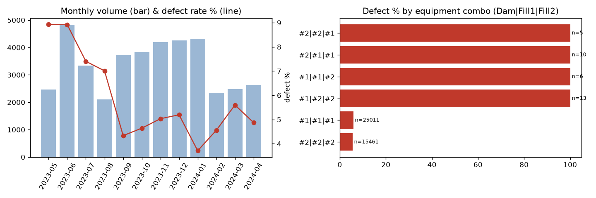
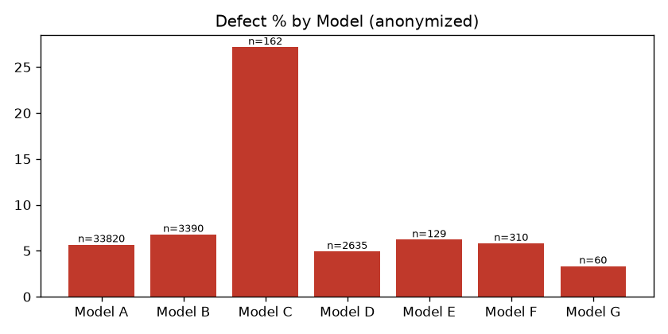

# 01. 데이터 프로파일링 (EDA)

> 사용 스킬: `hwp`(feature 설명 문서 변환), `explore-data`(프로파일링 프레임)
> 코드: `src/s01_eda.py` 외 `s01*.py` · 수치: `reports/01_eda_stats.json`, `reports/01_eda_tables.md` · 그림: `figs/01_*.png`

## 1. 개요

| 항목 | 값 |
|---|---|
| train | 40,506행 × 468열 (target 포함) |
| test | 17,361행 × 469열 (`Set ID` 추가, target 비어 있음) |
| 기간 | 2023-05-04 ~ 2024-04-28 (train·test 동일 기간, 월별 비중도 거의 같음 → **랜덤 분할**된 test) |
| 단위(grain) | 제품 1개(Set) = 1행. 4개 공정 기록이 옆으로 붙어 있음 |
| 타깃 | AbNormal 2,350건 (**5.80%**) / Normal 38,156건 → 불균형 이진 분류 |

### 공정 구성 (hwp 문서 기준)

`Dam 도포(외곽 가벽)` → `Fill1 도포(내측)` → `Fill2(UV 경화)` → 합착 → `AutoClave(탈포: 압력·시간·챔버온도)` → 완전경화 → 검사

- 불량 유형: **기포**(가장 흔함), **Misalignment**, **Crack(레진 수축)**
- 문서상 가설: *UV 경화 에너지가 기포의 주요 인자*, *탈포 압력·시간에 따라 기포 잔존*

| 공정 | 전체 열 | 유효 열(값 2종 이상) |
|---|---|---|
| Dam | 218 | 70 |
| Fill1 | 98 | 34 |
| Fill2 | 128 | 33 |
| AutoClave | 23 | 12 |
| **합계** | 467 | **149 (+target)** |

## 2. 데이터 품질 이슈

| 심각도 | 이슈 | 내용 | 조치(2단계) |
|---|---|---|---|
| 🔴 | **전부 결측 열 278개** | `Unit Time`, `Judge Value` 대부분이 비어 있음 | 삭제 |
| 🟠 | **상수 열 40개** | Wip Line, Process Desc., Insp Judge Code(전부 OK) 등 | 삭제 |
| 🔴 | **열 밀림(column shift)** | 아래 3절 | 원래 위치로 되돌림 |
| 🟡 | 숫자/문자 혼재 | `HEAD NORMAL COORDINATE X AXIS(Stage1)`에 `'OK'` 문자열 | 밀림 보정 후 숫자로 변환 |
| 🟡 | 메타 중복 | Model.Suffix·Workorder가 4개 공정에 똑같이 반복 | 1개만 유지 |
| 🟢 | 시간 문자열 | Collect Date 4종 (공정별) | datetime 변환 → 공정 간 소요시간 파생 |

## 3. 핵심 발견 ① — 2023-10부터 로그 포맷이 바뀌어 열이 한 칸 밀림

`HEAD NORMAL COORDINATE X AXIS(Stage1)` 값으로 행을 3그룹으로 나눌 수 있었다.

| 그룹 | 기간 | 행 수 | X(Stage1) 값 |
|---|---|---|---|
| A (정상 정렬) | 2023-05 ~ 09 | 16,447 | 숫자 (549 등) |
| B | 2023-10 ~ 12, 2024-03 ~ 04 | 12,766 | 결측 |
| C | 2023-12 ~ 2024-03 | 11,293 | `'OK'` |

그룹별 중앙값을 비교하니 **B·C 그룹은 X(Stage1)부터 WorkMode까지의 측정값이 오른쪽으로 한 칸씩 밀려** 있었다.

| 열 이름 | A 중앙값 | B/C 중앙값 |
|---|---|---|
| X AXIS(Stage1) | 549.0 | (결측/OK) |
| X AXIS(Stage2) | 463.0 | **549~550** ← 원래 Stage1 값 |
| X AXIS(Stage3) | 160.5 | **464~465** ← 원래 Stage2 값 |
| Y AXIS(Stage1) | 377.5 | **161~163** ← 원래 Stage3 값 |

- Dam·Fill1·Fill2 **세 공정 모두 같은 행**에서 밀려 있고(일치율 100%), **test에도 같은 비율**로 존재한다.
- 보정하지 않으면 같은 열에 서로 다른 물리량이 섞여, 모델이 "포맷 변경 시점"을 불량 신호로 잘못 학습할 수 있다.
- 그룹별 불량률이 A 7.3% / B 5.1% / C 4.4%로 다르지만, 이 차이는 **포맷 차이보다는 기간 효과**(초기 월 불량률이 높음)로 보는 것이 타당하다.

## 4. 핵심 발견 ② — 설비 조합이 어긋나면 불량률 100%

| 설비 조합 (Dam \| Fill1 \| Fill2) | n | 불량률 |
|---|---|---|
| #1 \| #1 \| #1 | 25,011 | 5.86% |
| #2 \| #2 \| #2 | 15,461 | 5.50% |
| #1\|#1\|#2, #1\|#2\|#2, #2\|#1\|#1, #2\|#2\|#1 | **34** | **100%** |

- 정상 흐름은 같은 번호의 라인을 그대로 타는 것이다. **라인을 바꿔 탄 34건은 전부 불량**이었다.
- test에도 12건이 있다. 그대로 **규칙으로 불량 판정**할 수 있는 확실한 신호다.
- 공정 해석: 라인을 바꿔 탄 제품은 재작업·우회 투입품일 가능성이 높다. 원인보다는 **이상 이력의 지표**로 해석해야 한다.

## 5. 범주별 불량률

- **월별**: 2023-05 ~ 06에 약 8.9%였다가 09월 이후 4 ~ 5%대로 내려옴. 초기 공정이 안정화된 효과로 추정된다(→ 시간 변수를 넣을지 신중히 판단).
- **모델(Model.Suffix)**: 모델 C이 **27.2%** (n=162, 평균의 4.7배). 다른 모델은 3 ~ 7%.

- **Workorder(663종)**: 불량률 중앙값 3.9%, 상위 10%는 12.7% 이상, 최대 48.9%(`WO-05`, n=88). 작업지시 단위로 불량이 몰리는 현상이 뚜렷하다.
  - 22%의 Workorder는 불량이 0건이다. 로트·자재 단위의 영향을 시사한다.
- **설비 단일 기준**: #1 5.9% vs #2 5.6%로 차이가 미미하다.
- **AutoClave Chamber Temp 판정(OK/NG)**: 5.84% vs 5.71%로 차이 없음. 판정값 자체에는 정보가 없다.

## 6. train / test 비교

- 월별 비중, 설비 비중, 모델 비중이 train과 test에서 거의 같다(차이 0.5%p 이내). test는 **같은 기간에서 무작위로 추출**한 것으로 보인다.
- 따라서 검증은 **Stratified K-Fold**를 기본으로 하고, 시간 기준 분할은 보조로 확인한다.

## 7. 다음 단계 (2단계 전처리)에 넘길 결정 사항

1. 전부 결측인 278열과 상수 40열 삭제 → 약 150열 남음
2. B·C 그룹의 **열 밀림을 한 칸 왼쪽으로 되돌리기** (Dam·Fill1·Fill2 각각, X(Stage1) ~ WorkMode 구간)
3. 메타 열은 공정별 중복을 제거하고 하나만 유지(Model.Suffix, Workorder). `설비 조합 불일치` 플래그 생성
4. Collect Date 4종으로 **공정 간 소요시간**(Dam→Fill1→Fill2→AutoClave) 파생
5. Workorder는 카디널리티가 높아(663) **타깃 인코딩은 누수 위험**이 있다. 폴드 내부에서만 계산(OOF)하거나 접두어로 그룹화
