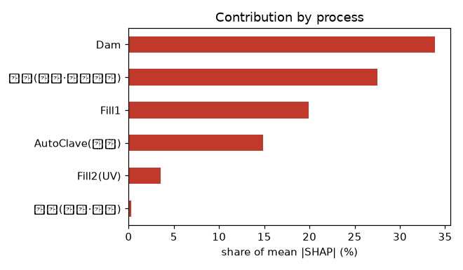
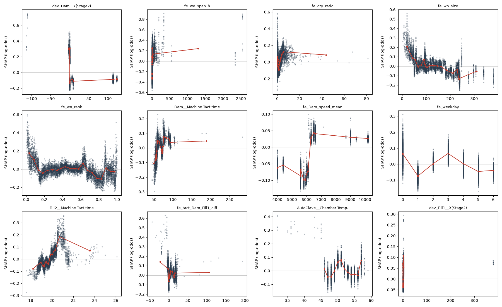

# 07. SHAP 해석과 원인 도출

> 사용 스킬: `shap`(설명 대상과 출력 단위 명시, hold-out 설명, 가법성 검증, 비인과 해석 원칙)
> 코드: `src/s07_shap.py` · 결과: `reports/07_shap_summary.json`, `07_shap_importance.csv` · 그림: `figs/07_*.png`

## 0. 설명 설정 (재현용 기록)

| 항목 | 값 |
|---|---|
| 모델 | LightGBM (5단계와 같은 하이퍼파라미터) |
| 피처 | `process_only` 146개. 시간(경과일·레시피), 작업지시 타깃 인코딩, **이미 규칙으로 확정된 변수**(리드타임·라인 혼입·Fill1 미도포)는 제외 |
| 학습 / 설명 대상 | 규칙 미해당 행만 사용. 학습 80%, **hold-out 20%(8,075행)를 설명** |
| 설명 출력 | **raw margin = 불량(AbNormal)의 log-odds**. 양수면 불량 위험 ↑ |
| 설명기 | TreeExplainer, tree_path_dependent (배경 데이터 없음) |
| 가법성 검증 | base + ΣSHAP vs 모델 raw score의 최대 오차 **1.2e-14 ✅** |
| hold-out 성능 | ROC-AUC 0.658, PR-AUC 0.183 (규칙으로 쉽게 잡히는 불량을 빼서 낮아짐) |
| SHAP 버전 | 0.54.1 |

> ⚠️ SHAP는 **모델이 무엇을 근거로 판단했는지**를 보여 준다. 인과를 증명하지 않는다. 아래 결론은 4단계 통계(레시피 층화)와 **교차 확인된 것**만 원인 후보로 올렸다.

## 1. 공정별 기여도

| 공정 | 평균 \|SHAP\| 비중 |
|---|---|
| **Dam (가벽 도포)** | **33.9%** |
| 운영 (작업지시 규모·순서·기간, 요일·시각) | 27.5% |
| Fill1 (내측 도포) | 19.9% |
| AutoClave (탈포) | 14.9% |
| Fill2 (UV 경화) | 3.5% |
| 모델·라인 | 0.3% |

→ **불량 판단의 1/3이 Dam 공정 조건에서 나온다.** hwp 문서는 UV 경화를 기포의 주요 인자로 봤지만, 이 데이터에서 Fill2(UV) 기여는 3.5%로 작다. 단, UV 에너지 자체가 아니라 **경화 속도·위치 설정값만 기록**되어 있어 측정 한계일 수 있다.

## 2. 상위 피처와 위험 구간 (SHAP 의존 곡선)

| 순위 | 피처 | 위험 방향 (SHAP > 0) | 4단계 통계와 교차 확인 |
|---|---|---|---|
| 1 | **Dam Y(Stage2) 좌표 편차** | **음수 편차**(기준보다 Y가 작음) → log-odds +0.3 | ✅ 구 레시피 8.5% vs 4.3%, 신 레시피 8.6% vs 3.8%. **라인 #1·#2 모두 약 2배** |
| 2 | 작업지시 생산 기간 | **24시간 넘게 이어진 작업지시** | ✅ 구 11.2% vs 4.7%, 신 6.8% vs 3.8% |
| 3 | 작업지시 내 생산 진행률 | 계획 대비 비정상 비율(재투입 의심) | |
| 4 | **작업지시 규모** | **60개 미만의 소량 작업지시** | 시험 생산(PXX) 19%와 같은 맥락 |
| 5 | **작업지시 내 투입 순서** | **처음 10 ~ 15%** (작업 시작 직후) → +0.2 ~ 0.5 | **셋업 초기 불량** 패턴 |
| 6 | Dam 택트타임 | 75초 이상 (구 레시피 90초 이상 8.95%) | |
| 7 | **Dam 헤드 이동속도 평균** | **약 6,200 이상**에서 위험으로 바뀜 | ✅ 4단계 1순위 원인과 같고 임계값도 일치 |
| 9 | Fill2 택트타임 | 20.5 ~ 21.5초 구간에 위험 집중 | |
| 11 | AutoClave 챔버 온도 | **45℃ 미만 저온**에서 +0.3 | 4단계: 46℃ 이하 8 ~ 11% |
| 12 | Fill1 X(Stage2) 좌표 편차 | 편차 발생 시 위험 ↑ | ✅ 4단계 견고 변수 |

### 4단계와 SHAP가 갈린 부분

- **Dam Y(Stage2) 편차**: 4단계 Mann-Whitney 검정에서는 신 레시피에서 유의하지 않았다. 값 대부분이 0(정상)이라 **순위 검정이 둔감했기 때문**이다. 구간으로 나눠 보면 양쪽 레시피 모두 2배다. **SHAP가 통계 검정의 맹점을 보완한 사례**다.
- 더 중요한 발견도 있다. 음수 편차 건수가 **구 레시피 10,291건 → 신 레시피 720건으로 급감**했다. 레시피 변경 때 **헤드 좌표 보정도 함께 이뤄졌을 가능성**이 있고, 신 레시피의 불량률 개선 일부는 이 정렬 개선 덕일 수 있다.

## 3. 상호작용 (상위)

| 강도 | 조합 | 해석 |
|---|---|---|
| 0.029 | 작업지시 생산 기간 × 생산 진행률 | 오래 끌면서 진행률도 비정상인 작업지시 = 중단·재개 |
| 0.019 | 탈포 압력×시간 × 작업지시 생산 기간 | 오래 걸린 작업지시에서 탈포 조건의 영향이 커짐 |
| 0.019 | Dam 택트 × Fill1 택트 | 두 도포 공정의 속도 불균형 → 공정 간 대기 |
| 0.013 | Dam 택트 × Dam Y(Stage2) 편차 | 정렬 불량과 느린 택트가 겹치면 위험 증폭 |

→ 단일 원인보다 **"작업 흐름이 끊기는 상황"**(장기 작업지시, 착수 초기, 공정 간 속도 불균형)에서 공정 편차가 **증폭**되는 구조다.

## 4. 최종 원인 정리 (통계 + SHAP 교차 검증)

| 순위 | 원인 | 메커니즘(추정) | 근거 | 관리 기준(제안) |
|---|---|---|---|---|
| 1 | **공정 간 정체 > 2시간** | 반경화된 레진이 변질된 상태로 합착·탈포 → 기포 | 99% 불량 (103건) | Fill2 → AutoClave **2시간 내 투입** 인터락 |
| 2 | **라인 혼입 / 재투입** | 재작업품 | 100% 불량 (34건) | 라인 간 이동품 별도 관리 |
| 3 | **Dam Stage2 헤드 Y 좌표 음수 편차** | 가벽 위치가 어긋나 내측 레진 경계가 흐트러짐 → Misalignment·기포 | 레시피·라인 무관 **2배** | 편차 0 ± 0.05 관리. 음수 편차 시 보정 알람 |
| 4 | **Dam 헤드 이동속도 과다 / 토출 시간 부족** | 가벽이 얇아지거나 끊김 | 레시피 층화 후에도 단조 증가, 약 2배 | 이동속도 **≤ 6,000** (권장 4,000 ~ 5,500), Stage2 토출 ≥ 8초 |
| 5 | **작업지시 착수 초기 · 소량 · 장기 작업지시** | 셋업 안정화 전 생산, 중단·재개 | SHAP 상위 + 층화 확인 | 착수 후 첫 10% 강화 검사, 작업지시 분할 지양 |
| 6 | 시험 생산 / 모델 C | 신규 모델 조건 미확립 | 19 ~ 27% | 양산 전 조건 셋업 검증 |
| 7 | 탈포 챔버 저온 (< 46℃) | 레진 점도 ↑로 기포 제거가 덜 됨 | 8 ~ 11% (소표본) | 챔버 온도 하한 관리 |
| – | UV 경화 조건 (hwp 가설) | | 기여 3.5%, 근거 약함 | UV 실제 조사량 측정 필요 |
