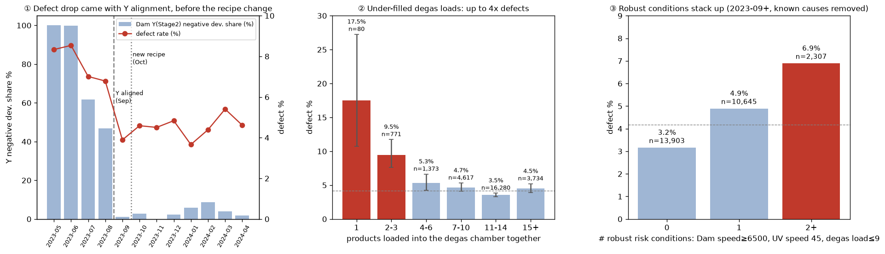

# 9월 이후 재분석 — 인사이트 보고서

> 기반: 16 ~ 25단계 분석, 23단계 점검(기간 교란 · 동시 통제 · 역인과 · 하위 집단 재현)을 통과한 결과만 실었다.
> 대상: **2023-09 ~ 2024-04**, 규칙 해당 제품·Dam Y(Stage2) 음수 편차 제품 제외 → **26,855건 · 불량 1,120건 (4.17%)**

---

## 한 줄 요약

> **불량률이 절반 가까이 줄어든 것은 레시피가 아니라 헤드 정렬 덕분이었다. 남은 불량의 가장 견고한 원인 후보는 "탈포기를 덜 채운 채 돌린 것"이다. 원인처럼 보였던 장기 대기는 "이미 문제가 생긴 결과"였다.**

---

## 인사이트 1. 불량률이 떨어진 건 9월, 레시피를 바꾼 건 10월

| 월 | 불량률 | 레시피 | Dam Y 음수 편차 비율 | Dam 이동속도 | Stage2 토출 시간 |
|---|---|---|---|---|---|
| 2023-07 | 7.4% | 구 | 62% | 9000 | 4.9초 |
| 2023-08 | 7.0% | 구 | 47% | 9000 | 4.9초 |
| **2023-09** | **4.3%** | **구** | **1%** | **9000** | **4.9초** |
| 2023-10 | 4.6% | 신 | 3% | 4000 | 10.5초 |

- 8월에서 9월로 넘어갈 때 **레시피, 이동속도, 토출 시간은 그대로**였다. 바뀐 것은 Dam 헤드의 Y 정렬 하나뿐이다.
- 다른 조건이 고정된 채 한 가지만 바뀐 **자연 실험**에 가깝다. 레시피를 바꾼 10월에는 불량률이 더 떨어지지 않았다.
- 설비별로 보면 더 분명하다. **두 설비가 서로 다른 시점에** Y 좌표 설정을 보정했고, **두 번 모두 보정 직후 불량률이 떨어졌다(보정 전후 4주: 8.2 → 6.1%, 9.4 → 4.3%).
  - 설비 1: 2023-07 중순 보정, 8.2% → 6.1%
  - 설비 2: 2023-08 중순 ~ 09-05 보정, 9.4% → 4.3%
  - 같은 2023-08에 보정을 마친 설비 1은 4.7%, 보정 전 설비 2는 12.6%였다.
- 2024-01 ~ 02에 설비 1에서 Y 음수 편차가 다시 11 ~ 17%로 늘었다 → **재발 감시가 필요**하다.

**So what**: 레시피 변경 같은 큰 조치보다 **헤드 정렬 관리**의 효과가 더 컸다. 정렬 편차 모니터링을 1순위 관리 항목으로 둔다.

## 인사이트 2. 탈포기를 덜 채우면 불량이 2.7배(1 ~ 3개 vs 10개 이상) ⭐

같은 시각에 탈포기에 함께 들어간 제품 수(배치 크기)별 불량률이다.

| 함께 넣은 제품 수 | 제품 수 | 불량률 |
|---|---|---|
| **1개** | 80 | **17.5%** |
| **2 ~ 3개** | 771 | **9.5%** |
| 4 ~ 6개 | 1,373 | 5.3% |
| 7 ~ 10개 | 4,617 | 4.7% |
| **11 ~ 14개** | 16,280 | **3.5%** (최저) |
| 15개 이상 | 3,734 | 4.5% |

- 월·모델·라인·시각을 통제해도 1 ~ 3개 배치는 **OR 3.1**이다.
- **8개 하위 집단(라인 2개, 탈포 레시피 2종, 주력 모델, 기간 3개)에서 모두 같은 방향**이었다. 이번 분석에서 가장 견고한 결과다.
- **역인과가 아니다.** 정상 대기(40분 이하) 제품만 봐도 유지되고, 배치 안에서 전부 불량이거나 전부 정상인 패턴이 없다(작은 배치의 83%는 불량 0건).
- **"식어서"도 아니다.** 탈포기가 계속 돌던 중(직전 탈포 10분 이내)이어도 작은 배치는 11.2%로 큰 배치(3.6%)의 3배다. 챔버 온도를 통제해도 그대로다.
- **언제 생기나**: 1 ~ 3개 배치 제품의 28%가 **하루 첫 5개 제품**이고, 4 ~ 9개 배치 제품의 19%가 **휴식 직전 제품**이다. 아침 첫 제품이 위험해 보였던 것(6.9%)은 배치 크기를 통제하면 사라진다.

**So what**: 탈포기 **최소 투입 수량(예: 4개 이상)** 기준을 시범 운영한다. 같은 시간대에 배치 크기만 바꾸는 A/B 시험으로 인과를 확인한다.

## 인사이트 3. 견고한 위험 조건 3가지 — 겹치면 2.2배

월 안 비교와 동시 통제를 모두 통과한 조건이다.

| 위험 조건 | 해당 제품 | 불량률 (해당 vs 나머지) | 월 안 차이 | 동시 통제 OR |
|---|---|---|---|---|
| **탈포 배치 ≤ 9개** | 4,857 | 6.07% vs 3.75% | 모든 달 + | 2.67 (1 ~ 3개 기준) |
| **UV 경화 속도 45** (과조사) | 2,261 | 6.50% vs 3.96% | 두 달 모두 + | 1.55 |
| **Dam Stage2 이동속도 ≥ 6,500** | 8,406 | 4.90% vs 3.84% | 네 달 모두 + | 1.40 |
| **탈포 챔버 온도 ≤ 46℃** | 270 | 7.78% vs 4.1% | – (희소) | 2.34 (배치 통제 후) |

| 겹친 조건 수 | 제품 수 | 불량률 |
|---|---|---|
| 0개 | 13,903 | **3.2%** |
| 1개 | 10,645 | 4.9% |
| **2개 이상** | 2,307 | **6.9%** |

- 아래 중첩표와 그림 ③은 해당 제품이 많은 앞의 세 조건으로 계산했다. 챔버 저온은 제품 수가 적어 따로 관리한다(온도 하한 47℃).
- UV 경화 속도 45는 실제로 UV를 더 많이 쬐는 조건이다. 수기 측정 기준 약 1,750mJ vs 1,650mJ다(17단계).
- 세 조건 모두 설비에서 바로 확인되는 값이라 **체크리스트형 위험 점수**로 쓸 수 있다.

> ⚠️ **이전 판에서 내린 조건**: "탈포 총시간 < 400"은 두 레시피가 섞인 달이 11월 하나뿐이고, 같은 날 Dam 속도도 바뀌어 기간 효과와 분리되지 않는다. "리드타임 > 45분"은 원인이 아니라 탐지 신호다(인사이트 4).

**So what**: Dam 이동속도 4,000 ~ 5,500, UV 경화 속도 48 이상을 기본값으로 시험한다.

## 인사이트 4. 오래 기다린 제품은 "원인"이 아니라 "결과"였다

처음에는 "탈포 전 45분 넘게 기다리면 불량 2.8배, 짧은 탈포와 겹치면 20%"로 보였다. 파고들어 보니 역인과였다.

| 장기 대기(45분 초과) 중 라인 상태 | 불량률 |
|---|---|
| 라인이 계속 가동 | **5.0%** (평소와 비슷) |
| 정기 휴식에 걸림 (전체) | 19.0% |
| └ 그중 30 ~ 60분 실제 휴식 | **4.7%** (30분 이하 짧은 "정기" 정지에 비정기 정지가 섞였을 가능성) |
| **비정기 정지에 걸림** | **51.3%** |

- 비정기 정지에서는 함께 기다린 제품이 **전부 불량이거나 전부 정상**이었다(일부만 불량 0%). 그리고 **짧은 정지일수록** 불량률이 높았다(30분 이하 78% vs 30 ~ 60분 36%).
- 대기가 원인이라면 오래 멈출수록 나빠야 한다. 실제로는 **"문제 제품 발견 → 라인 정지 → 해당 제품 대기"** 패턴에 맞는다.
- 이 제품들을 빼면 "대기 × 짧은 탈포" 상호작용은 사라진다(OR 2.5 → 1.35, p = 0.45).
- 기존 "2시간 초과 대기 = 99% 불량" 규칙도 같은 구조일 수 있다. 9월 이후 해당 제품의 44%가 비정기 정지에 걸려 있었다.

**So what**: 장기 대기·비정기 정지는 **불량 의심 제품을 골라내는 탐지 규칙**으로 쓴다. "대기를 줄이면 불량이 준다"는 인과 근거로 쓰지 않는다. 확정하려면 **정지 사유 코드**가 필요하다.

## 인사이트 5. 라인보다 "자재 로트"가 크다

| | 라인 #1 | 라인 #2 |
|---|---|---|
| 9월 이후 불량률 | 3.70% | 4.63% (p < 0.001) |
| 관리 한계 밖 날짜 | 4일 / 120일 | **9일** / 119일 |

- 라인 #2가 더 나쁘다. 하지만 **12-13과 02-15는 두 라인이 같은 날 함께 튀었다.**
- 그날의 작업지시는 **두 라인 모두에서** 불량률이 19 ~ 29%였다(예: WO-11 28.6%, WO-08 24.6%).
- 두 라인에 함께 투입된 작업지시 301개에서 **라인 #1과 #2의 불량률 상관은 0.44**다. 같은 작업지시면 어느 라인에서 만들어도 비슷하게 좋거나 나쁘다.
- 시험 생산(PXX) 작업지시는 8.3%로 일반(4.1%)의 2배다.
- 지금까지 찾은 조건으로는 라인 #2의 차이(OR 1.26)가 설명되지 않는다. 설비 고유 상태 같은 로그에 없는 정보가 남아 있다.

**So what**: 작업지시 착수 후 첫 20 ~ 30개의 검사 결과를 보고 해당 로트 자재를 점검한다. **자재 로트 번호를 제품 단위로 기록**하면 원인을 분리할 수 있다.

## 인사이트 6. 모델로는 "의심 제품 선별"까지

9월 이후·알려진 원인 제외 집단이다. 피처는 **test 한 행만으로 만들 수 있는 것**만 썼다(누수 검증 통과).

| 검증 | PR-AUC | 무작위 |
|---|---|---|
| 5-fold CV | 0.17 | 0.042 |
| **시간 순 (~2월 학습 → 3 ~ 4월)** | **0.10** | 0.049 |

- 미래 예측은 무작위의 **약 2배**다. 그 성능의 상당 부분은 리드타임, 즉 **"이미 문제가 생긴 제품"을 찾는 신호**에서 나온다.
- 휴식 겹침·공정 시각 같은 행 단위 시간 피처를 더해도 미래 예측은 유의하게 오르지 않았다(0.100 → 0.105).
- 배치 크기, 작업지시 상관 같은 강한 신호는 **다른 제품 행이 필요**하다. 그래서 test 한 행만으로는 만들 수 없지만, 현장 로그(전체 생산 흐름)에서는 실시간으로 만들 수 있다.

**So what**: 모델을 더 정교하게 만들기보다 **데이터를 더 모으는 것**이 우선이다. 정지 사유, 자재 로트, 불량 유형, UV·챔버 실측값이 필요하다.

---

## 정리: 불량은 어디서 왔고 무엇을 하면 되나

| 불량 구분 | 규모 | 설명 | 조치 | 근거 |
|---|---|---|---|---|
| 규칙으로 잡히는 불량 | 전체의 5.6% | 2시간 대기, 라인 변경 | **탐지 규칙**으로 분리 판정 | 강함 (탐지용) |
| Dam Y 정렬 불량 | 8월까지 다수 | 9월 불량률 하락의 주원인 | 정렬 편차 모니터링 | 강함 |
| **탈포 작은 배치** | 4,857건, 1 ~ 3개면 OR 3.1 | 하루 시작·휴식 직전 | **최소 투입 수량** 기준 | **강함** |
| UV 과조사 · Dam 고속 | OR 1.55 · 1.40 | 설정 조건 | 기본값 조정 시험 | 중간 |
| 탈포 챔버 저온 (≤ 46℃) | 270건, OR 2.34 | 배치와 독립 | 온도 하한 47℃ | 중간 (희소) |
| 자재 로트 | 작업지시 상관 0.44 | 두 라인 동시 악화 | 로트 기록·초기 점검 | 중간 |
| 비정기 정지 · 장기 대기 | 장기 대기 불량의 88% | 문제 발생의 결과 | 불량 의심 분리 판정 | 탐지용 |
| 라인 #2 편차 | OR 1.26 | 미설명 | 정비 이력 확인 | – |

## 현장 실행 제안

| 우선순위 | 조치 | 근거 |
|---|---|---|
| **즉시** | Dam 헤드 **Y 정렬 편차 알람** (2024-01 ~ 02 재발 이력) | 인사이트 1 |
| **즉시** | 탈포기 **최소 투입 수량(4개 이상)** 시범 운영, 하루 첫 가동·휴식 직전 배치 채우기 | 인사이트 2 |
| **즉시** | 탈포 **챔버 온도 하한 47℃** | 인사이트 3 |
| **즉시** | 비정기 정지 중 대기 제품·2시간 초과 대기 제품 **불량 의심 분리 판정** | 인사이트 4 |
| 단기 시험 | 배치 크기 A/B(6개 vs 12개), Dam 이동속도 4,000 ~ 5,500, UV 속도 48 이상 | 인사이트 2 · 3 |
| 운영 | 작업지시 착수 후 첫 20 ~ 30개 검사 결과로 로트 점검 | 인사이트 5 |
| 확인 | 12-13 · 02-15 자재 로트, 라인 #2 정비 이력 | 인사이트 5 |
| 데이터 | **정지 사유 코드, 자재 로트 번호, 탈포 배치 ID, 챔버·UV 실측값** | 인사이트 4 · 5 · 6 |

## 한계

- 모두 **관찰 연관**이다. 배치 크기, 이동속도, UV 조건은 시험으로 인과를 확인해야 한다.
- 배치 크기는 "같은 탈포 시각(10분 단위)에 기록된 제품 수"로 추정했다. 데이터가 전체 생산을 다 담고 있는지 확실하지 않아 **상대 크기**로 해석한다.
- 장기 대기·정지 결과의 역인과 해석은 정지 사유가 로그에 없어 직접 확인하지 못했다. 정지 단위의 전부/전무 패턴과 정지 길이의 역방향 관계로 추론했다.
- 인사이트 1의 "자연 실험"은 8월과 9월 사이에 기록되지 않은 다른 변화(작업자, 자재)가 없었다는 가정에 기댄다.
- 9월만 구 레시피라 레시피 효과는 월 효과와 분리되지 않는다.
