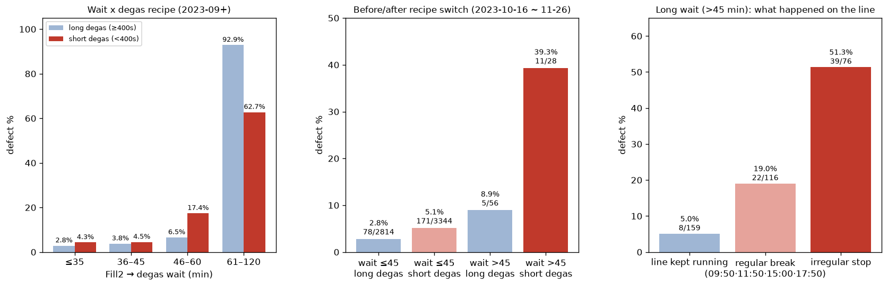

# 19. 탈포 전 대기 × 탈포 레시피 — 심층 분석

> 코드: `src/s19_wait_degas.py` · 결과: `reports/19_wait_degas.json`, `19_run.log` · 그림: `figs/19_wait_degas.png`
> 대상: 2023-09 이후, 라인 변경·Fill1 미도포·Dam Y(Stage2) 음수 편차 제외. 2시간 초과 대기는 구간표에만 포함
> ⚠️ **정정 (23단계 점검)**: §4-2 · §4-4 ③ · §8에서 근거로 든 "15단계 60분 이상 정지 후 재가동 위험"은 22 · 23단계에서 **재현되지 않았다**. "재가동 30분 제품 강화 검사" 제안은 근거가 약하다. 대기 × 탈포 상호작용(OR 2.5)은 §4-4 ④대로 철회한다.

## 0. 요약

> **처음에는 "오래 기다린 제품 × 짧은 탈포 = 불량 급증"(상호작용 OR 2.5)으로 보였다. 그러나 장기 대기 불량의 상당수는 비정기 정지에 걸린 제품이었고, 이 정지는 "문제가 터져서 멈춘 것"일 가능성이 높다(역인과). 이 제품들을 빼면 탈포 레시피와의 상호작용은 유의하지 않다(OR 1.35, p = 0.45). 남는 결론은 두 가지다. ① 장기 대기 자체의 위험은 약 3배로 남는다. ② 비정기 정지는 원인이 아니라 "문제 발생 신호"로 써야 한다.**

1. 대기 45분이 위험 문턱이고, 60분이 넘으면 탈포 레시피와 상관없이 대부분 불량이다. 단, 이 구간에는 역인과가 섞여 있다(§4-4).
2. 46~60분 구간에서 긴 탈포 6.5%, 짧은 탈포 17.4%였다. 전환 전후 3주 비교에서도 8.9% → 39.3%(p = 0.002)였다.
3. **비정기 정지에 걸린 제품을 빼면** 상호작용은 사라진다(OR 1.35, p = 0.45). 방향(긴 탈포가 유리)은 유지되지만 근거는 **약함**이다.
4. 비정기 정지의 패턴은 "기다려서 불량"이 아니라 **"문제 제품 때문에 정지"**에 맞는다. 정지마다 기다린 제품이 전부 불량이거나 전부 정상이고, 짧은 정지일수록 불량률이 높다(§4-4).
5. 정지 여부는 로그만으로 판정했다(수기 데이터 미사용).

## 1. 두 변수의 정의

| 변수 | 의미 | 값 |
|---|---|---|
| **Fill2 → 탈포 대기** | UV 반경화가 끝난 뒤 탈포기(AutoClave)에 들어가기까지 걸린 시간 | 10분 단위 기록. 보통 20 ~ 40분 |
| **탈포 레시피** | 탈포기 안에서 압력 단계별 유지 시간 | 아래 표 |

| 단계 | 긴 탈포 (~2023-11-05) | 짧은 탈포 (2023-11-06 ~) |
|---|---|---|
| 1단 | 0.31 × 241초 | 0.31 × 241초 |
| **2단** | **0.31 × 90 ~ 121초 (저압 유지)** | **0.49 × 1초 (사실상 생략)** |
| 3단 | 0.50 × 121초 | 0.50 × 121초 |
| 총시간 | 452 ~ 483초 | 360 ~ 363초 |

- 차이는 **2단 저압 유지 구간 하나**다. 긴 탈포는 낮은 압력을 1.5 ~ 2분 더 유지한 뒤 압력을 올린다.
- 전환일은 **2023-11-06**이다. 9 ~ 10월은 전부 긴 탈포, 12월 이후는 전부 짧은 탈포다.

## 2. 대기 구간 × 탈포 레시피 (2023-09 이후)

| Fill2 → 탈포 대기 | 긴 탈포 | 짧은 탈포 | 배율 |
|---|---|---|---|
| ≤ 35분 | 2.8% (n=4,537) | 4.3% (n=15,033) | 1.5배 |
| 36 ~ 45분 | 3.8% (n=3,440) | 4.5% (n=3,504) | 1.2배 |
| **46 ~ 60분** | **6.5%** (n=199) | **17.4%** (n=92) | **2.7배** |
| 61 ~ 120분 | 92.9% (n=14) | 62.7% (n=51) | – |
| > 120분 | 100% (n=9) | 100% (n=18) | – |

- 45분까지는 레시피에 따른 차이가 작다(1.2 ~ 1.5배).
- **46 ~ 60분에서 차이가 2.7배로 벌어진다.** 긴 탈포가 대기로 생긴 문제를 일부 회복시키는 구간이다.
- **60분이 넘으면 어느 레시피든 대부분 불량이다.** 탈포로 되돌릴 수 없는 지점(point of no return)으로 보인다. 61 ~ 120분 구간은 표본이 작다(n=14, 51).

## 3. 검증

### 3-1. 레시피 전환 전후 3주 비교 (2023-10-16 ~ 11-26)

| | 긴 탈포 (전환 전) | 짧은 탈포 (전환 후) | Fisher p |
|---|---|---|---|
| 대기 ≤ 45분 | 2.8% (78/2,814) | 5.1% (171/3,344) | < 0.001 |
| **대기 > 45분** | **8.9% (5/56)** | **39.3% (11/28)** | **0.002** |

- 대기가 길 때의 불량 상승폭이 전환 전에는 **3.2배**(2.8% → 8.9%), 전환 후에는 **7.7배**(5.1% → 39.3%)다.

### 3-2. 통제 로지스틱 (월 · 모델 · 라인 고정, 2시간 초과 제외)

| 항 | 오즈비 | 95% CI | p |
|---|---|---|---|
| 대기 > 45분 | 4.00 | 2.58 ~ 6.20 | < 0.001 |
| 짧은 탈포 | 4.96 | 2.80 ~ 8.81 | < 0.001 |
| **대기 > 45분 × 짧은 탈포 (상호작용)** | **2.50** | **1.41 ~ 4.43** | **0.002** |

- 상호작용 오즈비 2.5는 **두 조건이 겹치면 각각의 효과를 곱한 것보다 2.5배 더 나빠진다**는 뜻이다.
- ⚠️ **단, 이 결과는 §4-4에서 역인과 제품(비정기 정지)을 빼면 유의하지 않게 된다(OR 1.35, p = 0.45).**

### 3-3. 9월 이전 데이터로 재현 (모두 긴 탈포)

| 대기 | ≤ 35분 | 36 ~ 45분 | 46 ~ 60분 | 61 ~ 120분 | > 120분 |
|---|---|---|---|---|---|
| 불량률 | 4.3% | 4.1% | **10.0%** (n=30) | 83.3% (n=6) | 100% |

- 독립된 기간에서도 **45분 문턱과 60분 붕괴 패턴이 똑같이 나타난다.**
- 긴 탈포의 46 ~ 60분 불량률(10.0%)도 9월 이후 긴 탈포(6.5%)와 비슷하고, 짧은 탈포(17.4%)보다 낮다.

## 4. 왜 오래 기다리나 — 라인 정지 (로그 기준)

### 4-1. 정지를 찾는 방법 (수기 데이터 미사용)

- 같은 날, 같은 라인에서 **Fill2 완료 기록이 20분 이상 끊긴 구간**을 "라인 정지"로 정의했다. 2023-09 이후에서 986회가 나왔다.
  - train과 test 제품을 모두 썼다. 시각만 필요하고 라벨은 필요 없기 때문이다.
- 정지 시작 시각을 세어 보면 **매일 같은 시각에 반복되는 정지**가 있다. 09:50(177회), 11:50(146회), 15:00 ~ 15:10(128회), 17:50(27회)이다. 이것을 **정기 휴식**으로 분류했다(전체 정지의 53%, 중앙값 40분).
- 나머지 47%는 시각이 일정하지 않은 **비정기 정지**다(중앙값 30분). 설비 이상, 자재 교체, 작업지시 전환 등으로 추정된다.
- 제품의 Fill2 → 탈포 사이에 같은 라인의 정지가 시작되면 "대기 중 정지"로 봤다.

### 4-2. 결과

| 대기 중 라인 상태 | 일반 대기 (≤ 45분) | **장기 대기 (> 45분)** |
|---|---|---|
| 계속 가동 | 3.8% (n=20,006) | **5.0%** (8/159) |
| 정기 휴식에 걸림 | 3.8% (n=4,115) | **19.0%** (22/116) |
| **비정기 정지에 걸림** | 5.6% (n=2,383) | **51.3%** (39/76) |

- **라인이 계속 돌았다면 45분 넘게 기다려도 불량률은 평소 수준(5.0%)이다.** 위험한 것은 대기 시간 자체보다 **기다리는 동안 라인이 멈춘 상황**이다.
- 장기 대기의 55%가 정지에 걸려 있었다(일반 대기는 25%).
- **비정기 정지 + 장기 대기는 절반이 불량**이다. 비정기 정지는 대기가 짧아도 불량률을 높인다(5.6% vs 3.8%). 정지 자체가 **설비 이상의 신호**일 수 있다.
  - 15단계에서 확정된 "Dam 60분 이상 정지 후 재가동"과 같은 맥락이다.
- 정기 휴식에 걸린 장기 대기(19.0%)는 반경화 상태로 휴식 시간 동안 방치된 경우로 보인다.

### 4-3. 탈포 레시피와 겹쳐 보면 (장기 대기 제품만)

| 대기 중 라인 상태 | 긴 탈포 | 짧은 탈포 |
|---|---|---|
| 계속 가동 | 2.6% (3/116) | 11.6% (5/43) |
| 정기 휴식 | 19.7% (13/66) | 18.0% (9/50) |
| 비정기 정지 | 30.0% (9/30) | **65.2% (30/46)** |

- 긴 탈포의 완충 효과는 **계속 가동**과 **비정기 정지** 상황에서 보이고, 정기 휴식에서는 보이지 않는다.
- 각 칸의 표본이 30 ~ 116건으로 작아서 방향만 참고해야 한다. **정지 여부가 탈포 레시피보다 더 큰 변수**다.

### 4-4. 역인과 점검 — 비정기 정지는 "문제가 터져서" 멈춘 것인가

가설 두 개를 놓고, 각각이 맞다면 데이터에 어떤 흔적이 남을지 비교했다.

| 가설 | 예상 패턴 | 실제 |
|---|---|---|
| A. 오래 기다려서 불량 (대기가 원인) | 정지가 길수록 불량 ↑ · 기다린 제품 중 일부만 불량 | – |
| **B. 문제 제품 때문에 정지 (역인과)** | **정지가 짧을수록 불량 ↑ · 정지마다 전부 불량 아니면 전부 정상** | **일치** |

**① 정지 단위로 보면 결과가 전부 아니면 전무**

| 정지 종류 | 장기 대기 제품이 있었던 정지 | 정지당 제품 | 전부 불량 | 전부 정상 | 일부만 불량 |
|---|---|---|---|---|---|
| **비정기** | 78회 | 평균 2.0개 | **60%** | 40% | **0%** |
| 정기 휴식 | 102회 | 평균 1.9개 | 18% | 71% | 11% |

- 비정기 정지에서는 함께 기다린 제품이 **모두 불량이거나 모두 정상**이었다. 대기 시간 때문이라면 같이 기다린 제품 중 일부만 불량인 경우가 나와야 한다.
- 장기 대기 제품이 3개 이상이었던 비정기 정지 5회는 **불량이 0건**이었다.

**② 짧은 정지일수록 불량률이 높다**

| 정지 길이 | 비정기 정지 장기 대기 불량률 | 정기 휴식 장기 대기 불량률 |
|---|---|---|
| ≤ 30분 | **77.8%** (n=36) | 42.0% (n=50) |
| 30 ~ 60분 | 36.1% (n=36) | **4.7%** (n=43) |
| > 60분 | 38.5% (n=13) | 17.2% (n=29) |

- 대기가 원인이라면 오래 멈출수록 나빠야 하는데, 반대다. **문제 제품을 빼내거나 조치하고 바로 재가동하는 짧은 정지**에서 불량이 몰린다.
- 30 ~ 60분짜리 정기 휴식(실제 쉬는 시간)에 걸린 장기 대기는 **4.7%로 평소 수준**이다. 순수하게 휴식으로 기다린 것은 큰 문제가 아니라는 뜻이다.
- 30분 이하 "정기" 정지(42.0%)는 정기 시각 근처에서 일어난 비정기 정지가 섞였을 가능성이 있다.

**③ 정지 직후 재가동 제품**

| | 정지 전 30분 (일반 대기) | 재가동 후 30분 |
|---|---|---|
| 비정기 정지 | 5.5% | **7.0%** |
| 정기 휴식 | 4.3% | 3.7% |

- 비정기 정지 뒤 재가동한 제품은 7.0%로 높다(기준 4.2%). 설비가 불안정한 상태였다는 신호이고, 15단계의 "Dam 60분 이상 정지 후 재가동" 결과와 맞는다.

**④ 비정기 정지 제품을 빼고 상호작용을 다시 보면**

| | 긴 탈포 | 짧은 탈포 |
|---|---|---|
| 대기 ≤ 45분 | 3.1% (n=7,437) | 4.1% (n=16,684) |
| 대기 > 45분 | 8.8% (n=182) | 15.1% (n=93) |

| 항 | 오즈비 | p |
|---|---|---|
| 대기 > 45분 | **2.94** | **< 0.001** |
| 짧은 탈포 | 6.18 | < 0.001 |
| 대기 × 짧은 탈포 | 1.35 | **0.45 (유의하지 않음)** |

- **장기 대기 자체의 효과(약 3배)는 남는다.** 순수 대기도 위험 요인이다.
- **탈포 레시피와의 상호작용은 사라진다.** 앞에서 본 OR 2.5는 비정기 정지 제품, 즉 역인과에 크게 기대고 있었다.
- 전환 전후 3주 비교도 4.0%(2/50) → 19.0%(4/21)로 방향은 같지만, 표본이 너무 작다.
- "짧은 탈포" 주효과(6.18)는 월 고정효과와 겹쳐 있어 해석하지 않는다.

**→ 결론**: 비정기 정지 + 장기 대기는 **원인이라기보다 "이미 문제가 생긴 제품"의 흔적**일 가능성이 높다. 2시간 초과 대기 규칙(99% 불량)도 같은 구조일 수 있다. 9월 이후 2시간 초과 48건 중 44%가 비정기 정지에 걸려 있었다. 이 규칙들은 **불량을 잘 찾아내는 신호**로는 유효하지만, **"대기를 줄이면 불량이 준다"는 인과 근거로 쓰면 안 된다.**

## 5. 메커니즘 (추정)

**순수 대기 (근거: 중간)**
1. Fill2에서 UV로 **반경화**된 레진은 시간이 지나면서 점도가 오르고 표면이 굳는다.
2. 이 상태로 합착하면 미세 기포가 레진 안에 갇힌다. 비정기 정지를 빼도 장기 대기의 오즈비가 2.94로 남는다.
3. 긴 탈포의 2단 저압 유지가 기포를 빼는 데 도움이 될 수 있다. 방향은 맞지만 역인과를 빼면 유의하지 않다 → **가설 단계**.

**비정기 정지 (근거: 패턴 일치, 사유 미확인)**
- 문제 제품(정렬 실패, 도포 이상, 이송 걸림 등)이 생김 → 라인 정지 → 해당 제품이 오래 대기 → 불량 판정.
- 대기는 원인이 아니라 **결과**다. 정지 사유 코드가 있어야 확정할 수 있다.

## 6. 개선 여지

| 시나리오 | 대상 | 효과 추정 | 근거 |
|---|---|---|---|
| **비정기 정지 + 장기 대기 제품을 불량 의심으로 분리 판정** | 9월 이후 76건 (불량 39) | 검사 대상 0.3%로 불량 39건 포착 (정밀도 51%) | 강함 (탐지용) |
| 비정기 정지 후 **재가동 30분 제품 강화 검사** | 재가동 직후 제품 | 불량률 7.0% (기준 4.2%) | 중간 |
| 정기 휴식 직전 Fill2 투입 조정 | 정기 휴식에 걸린 장기 대기 116건 (불량 22) | 가동 중 수준(5.0%)이 되면 약 16건 감소. 단 30 ~ 60분 휴식은 이미 4.7% | 약함 |
| 장기 대기 제품에 긴 탈포 적용 | 장기 대기 · 짧은 탈포 93건 (불량 14) | 긴 탈포 수준(8.8%)이면 약 6건 감소 | **약함 (상호작용 비유의)** |

- 대상 건수는 train 기준(전체 생산의 약 70%)이다.
- **"대기를 줄이면 불량이 준다"는 기대 효과는 크게 잡으면 안 된다.** 장기 대기 불량의 상당수는 대기 전에 이미 문제가 있던 제품일 수 있다.

## 7. 한계 · 주의

- **역인과**(§4-4): 정지 사유가 로그에 없어서 "문제 → 정지"를 직접 확인하지는 못했다. 정지 단위의 전부/전무 패턴과 정지 길이의 역방향 관계로 추론한 것이다.
- **전환일(11-06)에 Dam 이동속도도 함께 바뀌었다**(4,000 → 6,500). 그래서 짧은 탈포의 주효과는 이동속도 효과와 섞여 있다.
- 장기 대기 표본이 작다(비정기 정지를 빼면 275건).
- 대기 시간은 10분 단위로 기록돼 있어 "45분 초과"는 실제로 "50분 이상"이다.
- 라인 정지는 Fill2 기록이 끊긴 것으로 추정했다. 정기/비정기 구분은 시작 시각으로만 나눴다. 정기 시각 근처의 비정기 정지가 정기로 분류됐을 수 있다.
- train은 전체 생산의 약 70%다. 정지 판정에는 test 시각까지 썼지만, 기록 누락으로 정지를 과대 추정했을 수 있다.

## 8. 제안

| 우선순위 | 조치 | 근거 |
|---|---|---|
| **즉시** | **비정기 정지 중 대기한 제품 플래그** → 불량 의심 분리 판정 | §4-4 (탐지 신호) |
| **즉시** | 비정기 정지 후 **재가동 30분 제품 강화 검사** | §4-4 ③ |
| **데이터 (최우선)** | **정지 사유 코드**(휴식·고장·자재·불량 조치) 기록 → 역인과 확정 | §4-4 · §7 |
| 단기 시험 | 정기 휴식 직전 투입 조정, 장기 대기 제품 긴 탈포 적용 | §4-3 · §6 (근거 약함 → 시험으로 확인) |
| 보고서 수정 | 기존 "2시간 대기 인터락"은 **원인 차단이 아니라 불량 탐지 규칙**으로 표현 | §4-4 결론 |
