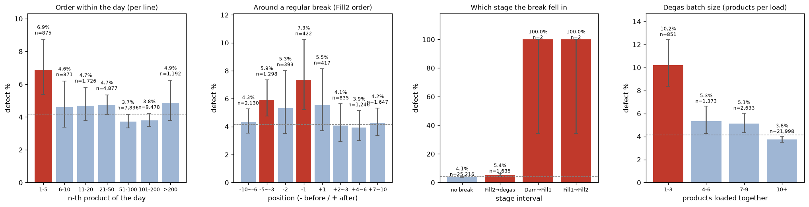

# 22. 생산 순번과 정기 휴식의 영향

> 코드: `src/s22_sequence_breaks.py` · 결과: `reports/22_sequence_breaks.json`, `22_run.log` · 그림: `figs/22_sequence_breaks.png`
> 대상: 2023-09 이후, 규칙(2시간 대기·라인 변경·Fill1 미도포)·Dam Y 음수 편차 제외 **26,855건** (전체 기간 40,374건으로 재현 확인)
> 원인 분석용이다. 다른 제품 행을 쓰므로 **모델 피처로는 쓰지 않는다.**

## 0. 요약

> **휴식이 영향을 주는 공정은 사실상 "Fill2 → 탈포 대기" 하나다. 그런데 휴식 자체보다 더 강한 원인은 "탈포기에 몇 개를 함께 넣었는가"였다. 1 ~ 3개만 넣은 작은 배치는 불량률이 10.2%로 평소(3.8%)의 2.7배다. 하루 첫 제품과 휴식 직전 제품이 위험해 보였던 것도 상당 부분 이 작은 배치로 설명된다.**

| 질문 | 답 |
|---|---|
| 순번별로 어디서 불량이 생기나 | **하루 첫 1 ~ 5번째 제품** 6.9% (평소 약 4%). 작업지시 안의 순번은 9월 이후 영향 없음 |
| 쉬는 시간이 있으면 어떤 영향이 있나 | **휴식 직전에 Fill2를 마친 제품**이 위험(직전 1번째 7.4%, 3 ~ 5번째 5.9%). **휴식 직후 재가동 제품은 영향 없음** |
| 어느 공정에서 휴식이 영향을 주나 | **Fill2 → 탈포 대기 구간**. 앞 공정 사이(Dam → Fill1 → Fill2)에서 휴식을 맞는 제품은 거의 없다(4건, 모두 불량) |
| 왜 그런가 | 하루 첫 제품과 휴식 직전 제품은 **탈포기에 적은 수로 들어가는** 경우가 많다. 작은 배치가 핵심 변수다 |

## 1. 순번 만들기

- `Dam__Production Qty`는 **라인별 하루 생산 카운터**다. 매일 0부터 세고, 하루 안에서 99.9% 단조 증가한다.
- 시각 기록이 10분 단위라 같은 칸 안에서는 순서를 알 수 없었는데, 이 카운터로 **정확한 생산 순서를 복원**했다.

| 순번 | 정의 |
|---|---|
| 하루 순번 | 그날 그 라인의 몇 번째 제품인지 |
| 작업지시 순번 | 같은 작업지시(라인별) 안에서 몇 번째인지, 끝에서 몇 번째인지 |
| 휴식 전후 순번 | 정기 휴식 직전 k번째(−k), 직후 k번째(+k). Fill2 완료 순서 기준 |

## 2. 정기 휴식 시각 (로그로 확인)

공정별로 하루 중 기록이 비는 시간대를 찾았다(수기 데이터 미사용).

| 공정 | 비는 시간대 |
|---|---|
| Dam · Fill1 · Fill2 | **10:00 – 10:20 · 12:00 – 13:00 · 15:10 – 15:30 · 17:50 – 18:00** (세 공정이 함께 멈춤) |
| 탈포기(AutoClave) | 10:30 · 12:30 – 13:30 · 15:50 (약 30분 늦게 빔) |

- 앞 공정 세 곳은 함께 쉰다. 탈포기만 30분 늦게 비는 것은 **휴식 전에 쌓인 대기열을 처리**하기 때문으로 보인다.
- 비정기 정지는 역인과(문제 발생 → 정지) 가능성이 있어 이번 분석에서 쓰지 않았다(19단계 참고).

## 3. 결과

### 3-1. 하루 순번 — 첫 제품이 위험

| 하루 순번 | 제품 수 | 불량률 (95% CI) |
|---|---|---|
| **1 ~ 5** | 875 | **6.86%** (5.4 ~ 8.7) |
| 6 ~ 10 | 871 | 4.59% |
| 11 ~ 50 | 6,603 | 4.7% |
| 51 ~ 200 | 17,314 | 3.7 ~ 3.8% |
| > 200 (19시 이후 잔업) | 1,192 | 4.87% |

- 아침 첫 5개 제품은 불량률이 **1.7배**다. 전체 기간 데이터에서는 8.9%로 더 뚜렷하다.
- 월·모델·라인·시각을 통제해도 OR 1.85(p < 0.001)다.

### 3-2. 작업지시 순번 — 9월 이후 영향 없음

| 작업지시 순번 | 9월 이후 | 전체 기간 |
|---|---|---|
| 1번째 | 4.97% | **7.26%** |
| 2 ~ 3번째 | 4.0 ~ 4.7% | 5.9 ~ 6.5% |
| 21 ~ 50번째 | 4.21% | 5.01% |

- 전체 기간에서는 작업지시 첫 제품이 높지만(OR 1.21), **9월 이후에는 차이가 없다**(OR 0.99). 초기 불안정기에만 있던 현상이다.
- 작업지시 마지막 제품도 차이가 없다.

### 3-3. 휴식 전후 — 휴식 "직전" 제품이 위험

| Fill2 완료 순서 | 제품 수 | 불량률 | 대기 중앙값 |
|---|---|---|---|
| 휴식 전 6 ~ 10번째 | 2,130 | 4.32% | 30분 |
| **휴식 전 3 ~ 5번째** | 1,298 | **5.93%** | 30분 |
| 휴식 전 2번째 | 393 | 5.34% | 30분 |
| **휴식 직전 1번째** | 422 | **7.35%** | 30분 |
| 휴식 직후 1번째 | 417 | 5.52% | 30분 |
| 휴식 후 2 ~ 10번째 | 3,728 | 3.9 ~ 4.3% | 30분 |

- **휴식 직전 1 ~ 5번째 제품**은 통제 후 OR **1.47**(p < 0.001)이다.
- **휴식 직후 재가동 제품은 영향이 없다**(OR 1.17, p = 0.28). "재가동하면 설비가 불안정하다"는 가설은 정기 휴식에서는 맞지 않는다. 비정기 정지 후에는 7.0%로 높았다(19단계).
- **기록된 대기 시간은 똑같이 30분**이다. 휴식 직전 제품이 위험한 이유는 "오래 기다려서"가 아니다(3-5 참고).

### 3-4. 어느 공정에서 휴식을 맞나

| 휴식이 걸린 구간 | 제품 수 | 불량률 |
|---|---|---|
| 안 걸림 | 25,216 | 4.08% |
| **Fill2 → 탈포** | 1,635 | **5.38%** |
| Dam → Fill1 | 2 | 100% (2/2) |
| Fill1 → Fill2 | 2 | 100% (2/2) |

- 정상 흐름에서는 Dam → Fill1 → Fill2가 몇 분 안에 끝난다. 그래서 휴식 전에 앞 공정이 비워지고, **휴식을 맞는 곳은 Fill2 → 탈포 대기열**이다.
- 앞 공정 사이에서 휴식을 맞은 제품은 9월 이후 4건, 전체 기간 6건인데 **모두 불량**이다. 표본이 너무 작아 결론을 낼 수는 없다. 다만 **"공정 중간에 멈춘 제품 = 위험"**이라는 신호로 관리할 가치는 있다.

### 3-5. 핵심 원인 후보 — 탈포기 배치 크기 ⭐

같은 시각에 탈포기에 함께 들어간 제품 수(train + test)를 배치 크기로 봤다.

| 탈포 배치 크기 | 제품 수 | 불량률 (95% CI) | 통제 OR |
|---|---|---|---|
| **1 ~ 3개** | 851 | **10.22%** (8.4 ~ 12.4) | **2.82** (2.16 ~ 3.69) |
| 4 ~ 6개 | 1,373 | 5.32% | 1.39 |
| 7 ~ 9개 | 2,633 | 5.13% | 1.29 |
| 10개 이상 | 21,998 | 3.75% | 기준 |

- **배치가 작을수록 불량률이 단조 증가**한다. 전체 기간에서도 같다(1 ~ 3개 11.6%, OR 2.21).
- **역인과 점검**
  - 정상 대기(40분 이하) 제품만 봐도 1개 배치 14.1%, 2 ~ 3개 배치 8.7%로 유지된다.
  - 배치 안에서 전부 불량이거나 전부 정상인 패턴도 없다. 작은 배치의 83%는 불량 0건, 전부 불량은 5%뿐이다.
  - → 비정기 정지처럼 "문제 제품이 따로 처리된" 흔적이 아니다.
- **언제 작은 배치가 생기나**: 1 ~ 3개 배치 제품의 **28%가 하루 첫 5개 제품**이다(큰 배치는 1.6%). 4 ~ 9개 배치 제품의 **19%가 휴식 직전 제품**이다(큰 배치는 6%). 시각으로는 08시, 10시, 13시, 15시에 몰린다. **하루 시작과 휴식 전후에 탈포기를 덜 채운 채 돌린** 것이다.

**배치 크기를 넣고 다시 통제하면** (9월 이후)

| 항 | 배치 미통제 OR | **배치 통제 OR** |
|---|---|---|
| 하루 첫 5개 | 1.85 (p < 0.001) | **1.26 (p = 0.20, 유의하지 않음)** |
| 휴식 직전 1 ~ 5번째 | 1.47 (p < 0.001) | **1.33 (p = 0.007)** |
| 휴식 직후 1 ~ 3번째 | 1.17 | 0.91 |

- **하루 첫 제품의 위험은 대부분 작은 배치로 설명된다.**
- 휴식 직전 제품의 위험은 일부(약 30%)만 설명되고 나머지가 남는다. 휴식 전에 서둘러 작업했다거나, 탈포기 대기열에서 위치가 달라지는 등의 다른 요인이 있을 수 있다.

## 4. 메커니즘 (추정)

- 탈포기는 챔버 안 압력과 온도로 기포를 뺀다. **적게 넣으면 열용량이 작아 챔버 온도가 빨리 변하거나**, 압력 단계가 제품 수에 맞춰 설계된 조건과 달라질 수 있다.
- 또는 작은 배치는 **예열이 덜 된 상태(아침 첫 가동)**나 휴식 직전의 급한 투입처럼 운영 조건이 달라지는 상황의 표지일 수 있다.
- 로그의 탈포 설정값(압력·시간)은 배치 크기와 상관없이 같았다(총시간 중앙값 363초, 1단 압력 0.307). 그래서 **같은 레시피를 적은 수량에 그대로 적용한 것**이 문제일 가능성이 있다.
- 작은 배치일수록 **챔버 온도가 조금 낮았다**(중앙값 1 ~ 3개 51℃ vs 10개 이상 53℃). 예열 부족 가설과 방향이 맞는다.

## 5. 한계

- 배치 크기는 "같은 탈포 시각에 기록된 제품 수"로 추정했다. 카운터 간격(주로 2씩 증가)을 보면 데이터가 전체 생산을 다 담고 있는지 확실하지 않다. **절대 개수가 아니라 상대 크기**로 해석해야 한다.
- 탈포 시각이 10분 단위라, 같은 10분 안의 서로 다른 두 사이클이 한 배치로 합쳐졌을 수 있다.
- 모두 관찰 연관이다. 배치 크기 효과는 **같은 시간대에 배치 크기만 바꾸는 시험**으로 확인해야 한다.

## 6. 제안

| 우선순위 | 조치 | 근거 |
|---|---|---|
| **즉시** | 탈포기 **최소 투입 수량 기준** 검토 (예: 6개 미만이면 다음 배치와 합치거나 강화 검사) | 3-5 |
| **즉시** | 하루 첫 가동 전 **탈포기 예열·더미 운전** 확인 | 3-1 · 3-5 |
| 단기 시험 | 휴식 직전 30분은 **Fill2 투입 속도를 맞춰** 탈포 배치를 채워서 보내기 | 3-3 · 3-5 |
| 관리 | 공정 중간(Dam → Fill2 사이)에서 휴식을 맞은 제품 플래그 | 3-4 |
| 데이터 | **탈포기 배치 ID·챔버 실측 온도/압력 곡선** 기록 | 4 |
