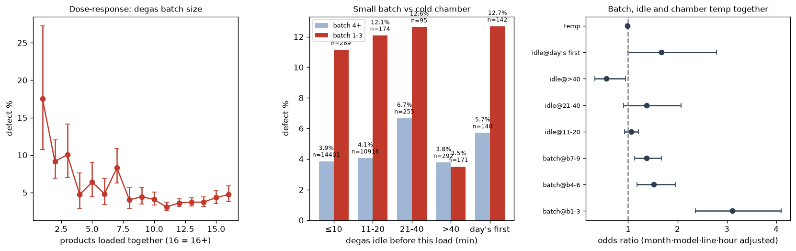

# 24. 탈포 배치 크기 심층 분석 — "적게 넣어서"인가 "식어서"인가

> 코드: `src/s24_batch_deepdive.py` · 결과: `reports/24_batch_deepdive.json`, `24_run.log` · 그림: `figs/24_batch_deepdive.png`
> 대상: 2023-09 이후, 규칙·Dam Y 음수 편차 제외 26,855건. 원인 분석용이다(다른 제품 행 사용).

## 0. 요약

> **탈포기가 계속 돌던 중이어도 1 ~ 3개만 넣으면 불량률이 11.2%로 큰 배치(3.6%)의 3배다. 탈포기 휴지 시간과 챔버 온도를 함께 통제해도 배치 효과는 OR 3.1로 그대로다. "예열 부족"보다 "적은 수량 자체"가 핵심이다.**

## 1. 용량-반응

| 함께 넣은 제품 수 | 제품 수 | 불량률 (95% CI) |
|---|---|---|
| **1개** | 80 | **17.5%** (10.7 ~ 27.3) |
| 2 ~ 3개 | 771 | 9.2 ~ 10.0% |
| 4 ~ 6개 | 1,373 | 4.7 ~ 6.4% |
| 7 ~ 10개 | 4,617 | 4.0 ~ 8.3% |
| **11 ~ 14개** | 16,280 | **3.1 ~ 3.7%** (최저) |
| 15 ~ 16개 이상 | 3,734 | 4.3 ~ 4.7% |

- 1개일 때 가장 높고, **11 ~ 14개에서 가장 낮다.** 15개를 넘으면 다시 조금 오른다. 적정 투입량이 있다는 뜻이다.

## 2. "식어서"인가 — 탈포기 휴지 시간 (직전 탈포 이후 경과)

| 직전 탈포 이후 | 배치 4개 이상 | **배치 1 ~ 3개** |
|---|---|---|
| ≤ 10분 (계속 가동 중) | 3.9% (n=14,401) | **11.2%** (n=269) |
| 11 ~ 20분 | 4.1% | **12.1%** |
| 21 ~ 40분 | 6.7% | **12.6%** |
| > 40분 | 3.8% | 3.5% (n=171) |
| 그날 첫 탈포 | 5.7% | **12.7%** |

- **탈포기가 계속 돌던 중(≤ 10분)에도 작은 배치는 3배 위험하다.** 그래서 "예열 부족" 가설로는 설명되지 않는다.
- 40분 넘게 쉰 뒤의 작은 배치는 오히려 낮다(3.5%). 긴 휴식 후 정상 재가동처럼, 운영 맥락이 다른 경우일 수 있다.

## 3. 동시 통제 (월 · 모델 · 라인 · 시각)

| 항 | 배치만 | + 휴지 시간 | + 휴지 시간 + 챔버 온도 |
|---|---|---|---|
| **배치 1 ~ 3개** | **3.13** | 3.13 | **3.11** (2.36 ~ 4.10) |
| 배치 4 ~ 6개 | 1.50 | 1.52 | 1.52 |
| 배치 7 ~ 9개 | 1.37 | 1.37 | 1.37 |
| 그날 첫 탈포 | – | 1.67 (p = 0.05) | 1.67 |
| 챔버 온도 (1℃) | – | – | 0.99 (p = 0.18) |

- 휴지 시간과 챔버 온도를 넣어도 **배치 효과는 전혀 줄지 않는다.**
- 챔버 온도를 **직선(1℃당)**으로 넣으면 영향이 없다. 작은 배치의 온도가 조금 낮았던 것(51℃ vs 53℃)도 배치 효과를 설명하지 못한다.
- ⚠️ **단, 46℃ 이하의 낮은 구간은 따로 위험하다**(9월 이후 n=270, 7.8%). 배치 크기를 함께 통제해도 **OR 2.34**(p < 0.001)이고, 저온 제품의 배치 크기 분포는 평소와 같다. 즉 **작은 배치와 저온 챔버는 서로 독립적인 두 위험 요인**이다(16_actionable 3번과 일치).

## 4. 메커니즘 후보 (검증 필요)

| 후보 | 근거 | 판정 |
|---|---|---|
| 예열 부족 / 챔버 냉각 | 가동 중에도 작은 배치가 위험, 온도 통제 후에도 유지 | ✗ 주원인 아님 |
| **적은 수량에 같은 레시피 적용** | 레시피(압력·시간)는 배치 크기와 무관하게 동일 | △ 가능 — 챔버 부피 대비 제품이 적으면 가압·감압 속도나 열 분포가 달라질 수 있음 |
| **작은 배치를 만드는 운영 상황** | 하루 시작·휴식 직전에 몰림 | △ 가능 — 급한 투입, 대기열 정리 등 |
| 데이터 착시 (10분 칸 병합) | 같은 10분 안 두 사이클이 하나로 합쳐질 수 있음 | △ 큰 배치 쪽을 과대 추정할 수 있으나, 작은 배치 정의에는 영향이 작음 |

## 5. 제안

| 우선순위 | 조치 |
|---|---|
| **즉시** | 탈포기 **최소 투입 수량(예: 4개 이상)** 기준 시범 운영. 미달이면 다음 배치와 합치기 |
| 단기 시험 | 같은 시간대에 배치 크기만 바꾸는 A/B (6개 vs 12개) → 인과 확인 |
| 데이터 | **탈포기 배치 ID, 챔버 압력·온도 곡선**(설정값이 아닌 실측) 기록 |
