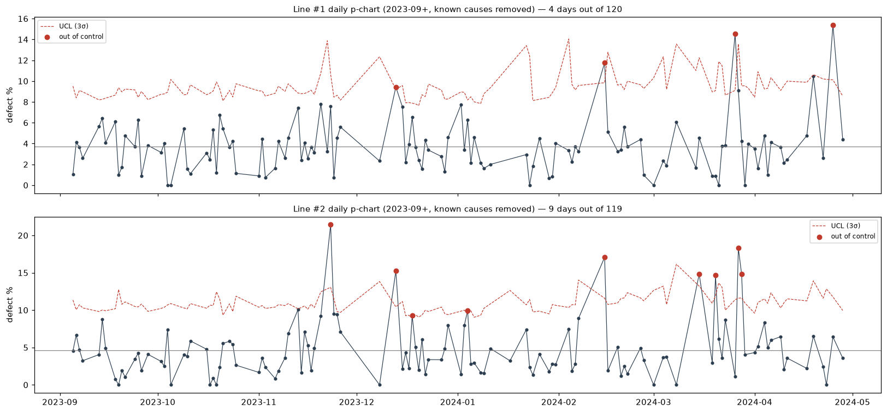

# 25. 라인별 일일 p-관리도 — 튄 날에는 무엇이 달랐나

> 코드: `src/s25_line2_spc.py` · 결과: `reports/25_line_spc.json`, `25_run.log` · 그림: `figs/25_line_spc.png`
> 대상: 2023-09 이후, 규칙·Dam Y 음수 편차 제외. 하루 30건 이상인 날만

## 0. 요약

> **라인 #2는 관리 한계를 넘은 날이 9일로 라인 #1(4일)의 2배다. 그런데 튄 날의 상당수는 두 라인이 함께 튀었고, 같은 작업지시가 양쪽에서 동시에 나빴다. 라인 자체보다 자재 로트(작업지시) 단위의 원인이 더 크다.**

## 1. 관리 한계 밖 날짜

| 라인 | 중심선 | 이상일 | 날짜 |
|---|---|---|---|
| #1 | 3.70% | 4 / 120일 | 12-13, 02-15, 03-26, 04-25 |
| #2 | 4.63% | **9 / 119일** | 11-23, **12-13**, 12-18, 01-04, **02-15**, 03-15, 03-20, 03-27, 03-28 |

- **12-13과 02-15는 두 라인이 같은 날 함께 튀었다.** 라인 고유 문제가 아니라 공통 원인(자재·환경)이 있었다는 뜻이다.
- **3월 하순(03-15 ~ 28)에 라인 #2가 4번** 튀었다. UV 경화 속도 45를 쓴 기간(03-18 ~ 28)과 겹친다. 이상일의 UV 45 비율은 28%, 정상일은 6.5%다.

## 2. 같은 작업지시가 두 라인에서 동시에 나빴다

| 작업지시 | 투입 라인 | 제품 수 | 불량률 | 날짜 |
|---|---|---|---|---|
| WO-11 | #1 · #2 | 70 | **28.6%** | 02-07, 02-15 |
| WO-08 | #1 · #2 | 57 | **24.6%** | 12-13 |
| WO-07 | #1 · #2 | 63 | **19.0%** | 12-13 |
| WO-19 | #1 · #2 | 101 | 15.8% | 04-24, 04-25 |
| WO-09 | #1 · #2 | 182 | 12.6% | 12-18 |

- 두 라인에 함께 투입된 작업지시 301개(각 15건 이상)에서, **라인 #1과 #2의 불량률 상관이 0.44**다.
- 같은 작업지시면 어느 라인에서 만들어도 비슷하게 좋거나 나쁘다. **작업지시에 딸린 자재(레진·패널 로트)**가 원인일 가능성이 높다.

## 3. 라인 #2 차이는 설명되나

| 모델 | 라인 #2 OR | p |
|---|---|---|
| 월 · 모델 · 시각 통제 | 1.26 | < 0.001 |
| + 작은 배치 · Dam 고속 · UV 45 | 1.26 | < 0.001 |
| + Dam · Fill1 좌표 편차 | 1.19 | 0.023 |

- 지금까지 찾은 조건으로는 라인 #2의 차이가 **거의 설명되지 않는다.** 남는 차이(OR 1.2)는 설비 고유 상태(정비 이력, 헤드 마모 등) 같은 로그에 없는 정보일 가능성이 있다.
- 좌표 편차의 라인 간 수준 차이(라인 #2 중앙값 114 vs 3)는 라인별 좌표 기준값이 달라서 생긴 구조적 차이다. 불량과는 관계가 약하다(p = 0.22).

## 4. 제안

| 우선순위 | 조치 |
|---|---|
| **즉시** | 작업지시 착수 후 **첫 20 ~ 30개 불량률 모니터링** → 높으면 해당 로트 자재 점검 (두 라인 공통) |
| 확인 | **12-13 · 02-15 투입 자재 로트**(레진·패널) 이력, 라인 #2의 11월 하순 · 3월 하순 정비 이력 |
| 데이터 | **자재 로트 번호를 제품 단위로 기록** — 작업지시 상관 0.44의 원인 분리 |
