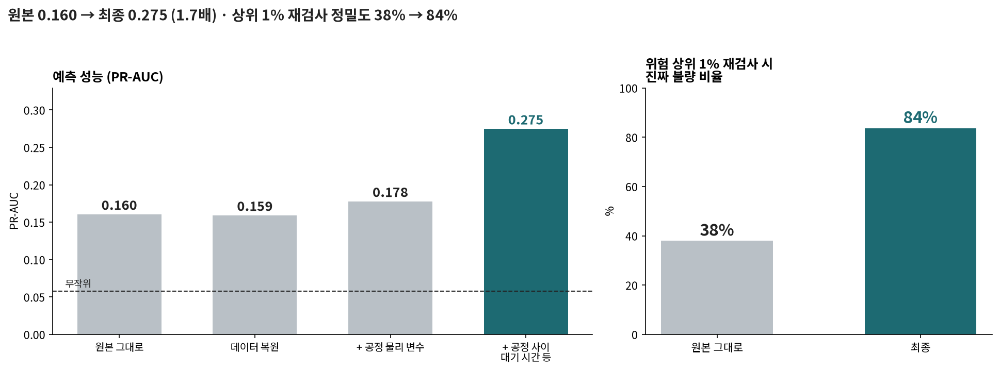
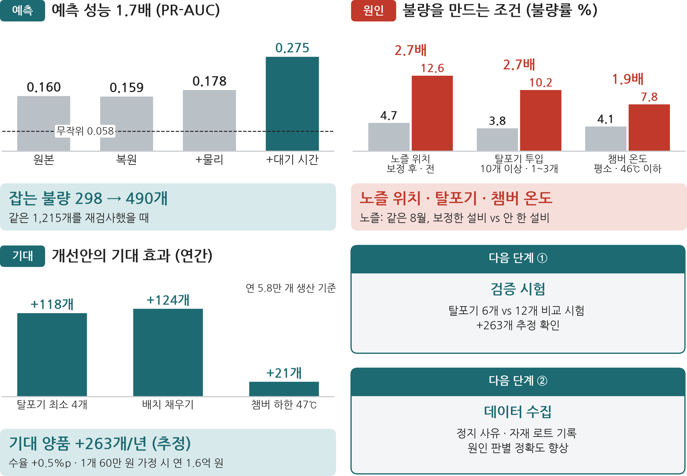
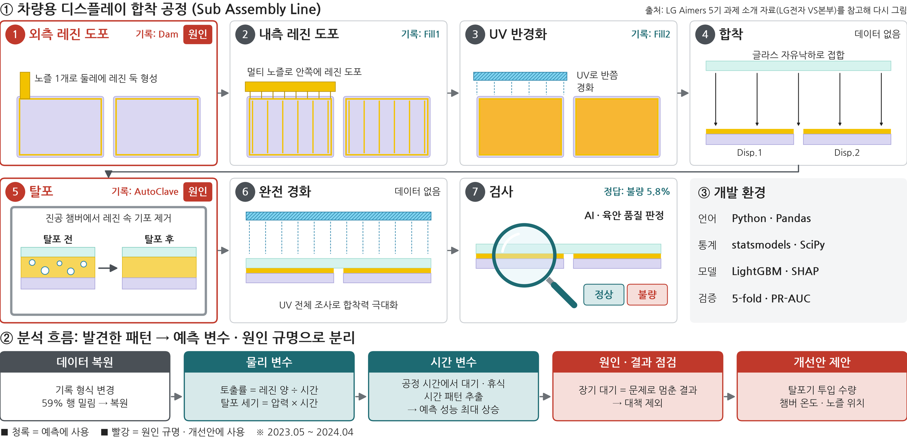
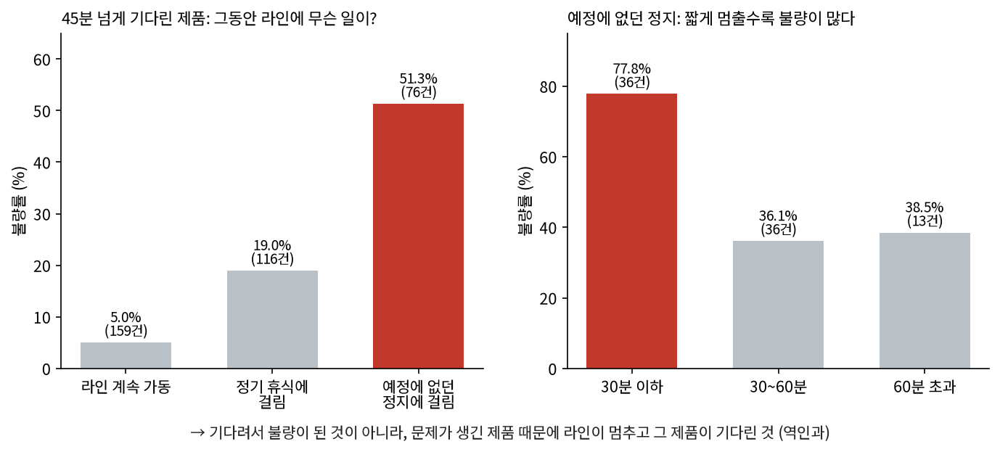
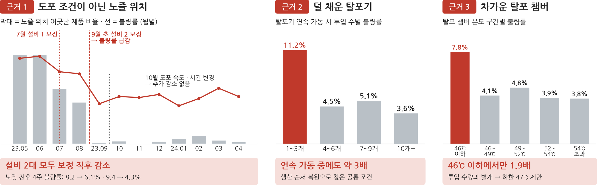
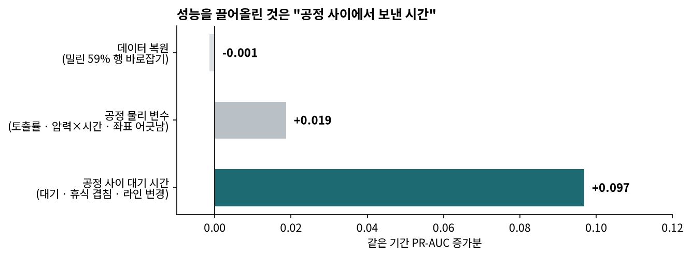
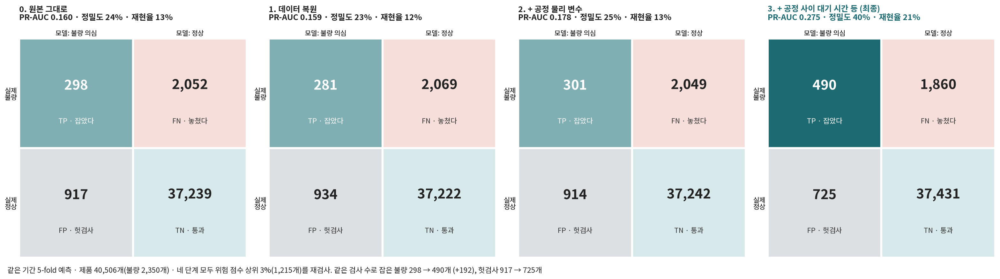
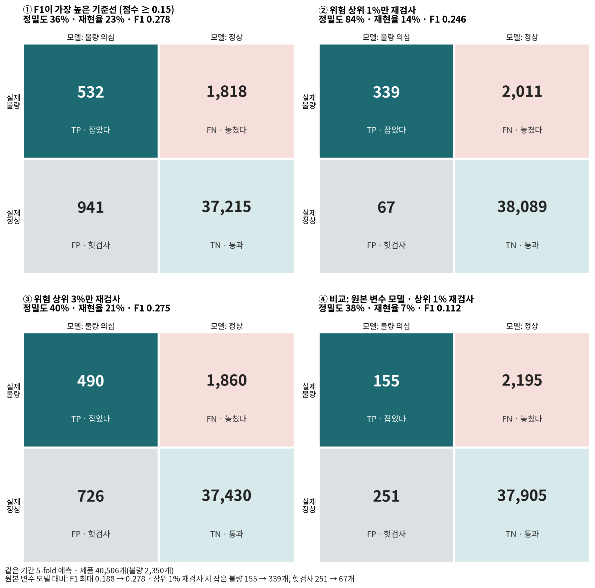
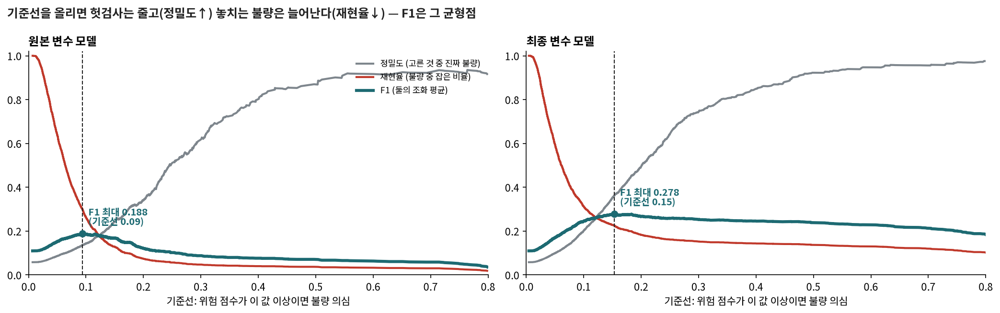
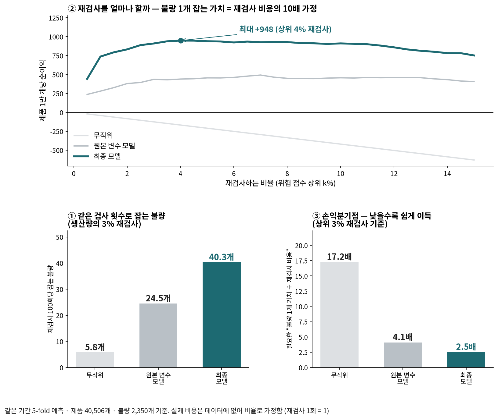

# LG전자 차량용 디스플레이 생산 라인(Sub Assembly) 데이터 기반 불량 예측 및 원인 분석
## 공정 로그 분석으로 예측 성능 1.7배 · 불량 원인 3가지 규명

> **차량용 디스플레이 합착 공정 · 제품 4만 건 로그 · LG Aimers 5기 본선 데이터 · 개인 프로젝트**

---

## 한눈에 보기

> 차량용 디스플레이 공장에서 **100개 중 6개가 불량**으로 버려진다. 공정 기록 4만 건을 분석해 불량과 이어지는 패턴을 찾았고, 그것을 두 갈래로 썼다. **① 불량일 제품을 미리 골라내는 모델**의 변수로, **② 불량을 만드는 원인을 고치는 조치**로.

| 골라내기 (예측) | 원인 찾기 |
|---|---|
| 예측 성능 **1.7배** (PR-AUC 0.160 → 0.275) | 과거 불량 감소는 도포 조건(레시피) 변경이 아니라 **Stage2 구간의 노즐 위치** |
| 위험 상위 1% 재검사 시 진짜 불량 **38% → 84%** | 기포 빼는 기계를 **덜 채우면 불량 2.7배** |
| 같은 1,215개 재검사로 잡는 불량 **298 → 490개** | 개선안으로 양품 **+263개/년** (추정) |

*① 골라내기 — 원본 측정값에 공정 흐름으로 설계한 변수를 더할수록 성능이 올랐다 (자세히: 4장)*

*결론 요약: 예측 성능 · 불량 조건 · 개선안을 적용할 때 기대되는 양품 (자세히: 5장)*

### 핵심 두 가지

| 질문 | 답 |
|---|---|
| **무엇이 성능을 올렸나** | 모델을 바꾼 게 아니다. 공정 흐름에 맞춰 설계한 변수, 특히 **공정 사이 대기 시간**이었다. 단, 이 신호는 원인이 아니라 문제의 흔적이라 예측에만 썼다 |
| **무엇이 원인이었나** | 첫 분석에서 얻은 "레시피 덕분"이라는 결과를 월별로 다시 검증해 뒤집었고, 가장 강해 보였던 "오래 기다림"이 **원인이 아니라 결과**임을 스스로 확인해 걸러냈다 |

> 처음 읽는다면 **2장(읽는 법)**을 먼저 보고, 결과만 보려면 **4장(골라내기)**과 **5장(원인 찾기)**으로 바로 가면 된다.

---

## 1. 문제

**차량용 디스플레이**는 디스플레이 두 장 위에 커버 글라스 한 장을 투명 레진으로 붙여 만든다. 공정 로그에는 도포 구간이 Stage1 · 2 · 3으로 기록돼 있다.

| 단계 | 하는 일 |
|---|---|
| Dam 도포 | 화면 가장자리에 레진으로 둑(가벽)을 그린다 |
| Fill1 도포 | 둑 안쪽을 레진으로 채운다 |
| Fill2 · UV | 자외선을 쬐어 레진을 반쯤 굳힌다 |
| 합착 | 두 장을 붙인다 |
| 탈포 | 기계(탈포기)에 여러 개를 함께 넣고 압력을 걸어 레진 속 기포를 뺀다 |
| 검사 | 정상 / 불량 판정 |

불량 하나는 화면 한 장을 버린다는 뜻이고, 모든 제품을 정밀 검사하기는 비싸다. 그래서 두 가지가 필요하다.

| | ① 골라내기 (예측) | ② 원인 찾기 |
|---|---|---|
| 질문 | 이 제품은 불량일까? | 불량은 왜 생기고, 무엇을 고쳐야 하나? |
| 효과 | 같은 검사 비용으로 더 많은 불량을 잡는다 | 애초에 버리는 화면이 준다 (근본 해결) |
| 필요한 것 | 불량을 잘 **맞히는** 변수 | 불량을 **만드는** 원인 (같이 움직이는 것과 구분) |
| 이 보고서 | 4장 | 5장 |

---

## 2. 데이터와 읽는 법

결과를 보기 전에, 이 보고서의 숫자와 그림을 읽는 법을 먼저 정리한다.

### 2-1. 데이터

| 항목 | 내용 |
|---|---|
| 규모 | 제품 40,506개 (정답 있음) · 2023년 5월 ~ 2024년 4월 |
| 한 행 = 제품 하나 | 공정 4곳의 **설비 설정값**(노즐 위치, 레진 양, 토출 속도, UV 속도, 탈포 압력·시간 등)과 **공정을 지난 시각** |
| 정답 | 정상 / 불량 (불량 2,350개) |

### 2-2. 모델은 어떻게 판단하나 — 위험 점수

모델(LightGBM)은 **"조건 → 점수 가감" 규칙을 가진 작은 나무 600개**의 모임이다.
1. 모든 제품은 평균 불량률(약 4%)에서 출발한다.
2. 나무마다 "공정 사이 대기가 2시간 넘나?", "Stage2 노즐이 기준보다 어긋났나?" 같은 조건을 보고 점수를 조금씩 올리거나 내린다.
3. 600개를 모두 더한 값을 0 ~ 1 사이 **위험 점수(불량일 확률)**로 바꾼다.

**실제 제품 세 개** (2024년 4월 제품 예시)

| 제품 | 위험 점수 | 실제 | 점수를 크게 움직인 변수 |
|---|---|---|---|
| A | **0.967** | 불량 | Dam → 탈포 총 **3.2시간**(크게 올림), 평소 거의 0분인 **Dam → Fill1 구간에서 160분** 대기(크게 올림) |
| B | 0.036 | 정상 | 총 50분 대기(조금 올림), 경화 시간 정상 · Stage2 노즐 어긋남 작음(조금 내림) |
| C | 0.009 | 정상 | 경화 시간 · Stage2 노즐 위치 · 탈포 조건 모두 정상 → 전부 조금씩 내림 |

### 2-3. 점수 → 정상 / 불량 의심 (0 / 1)

| | 점수 기준선 | 상위 k% |
|---|---|---|
| 나누는 법 | 점수가 기준선(예: 0.15) 이상이면 불량 의심 | 점수 순으로 줄 세워 **맨 위 k%**만 불량 의심 |
| 전체 40,506개 예 (실제 불량 2,350개) | 기준선 0.15 → **1,473개**가 불량 의심, 그중 불량 532개(36%) | 상위 1% → **406개**, 그중 불량 339개(84%) |
| 장점 | 하나의 숫자로 단순. 더 많이 잡는다 | 검사 개수가 항상 일정. 공정 조건이 바뀌어 점수 크기가 출렁여도 **순서는 유지** |
| 맞는 현장 | 놓치면 안 되는 경우 | **검사 인력 · 시간이 정해진 경우** |

대회 제출에는 기준선 방식을, 현장 운영 제안에는 상위 k% 방식을 썼다.

### 2-4. 맞힌 것과 틀린 것 — 혼동행렬 4칸

| 칸 | 뜻 | 현장 의미 |
|---|---|---|
| **TP** | 불량을 불량 의심으로 | 재검사로 **잡았다** |
| **FP** | 정상을 불량 의심으로 | **헛검사** (비용만 듦) |
| **FN** | 불량을 정상으로 | **놓쳤다** (불량이 그대로 나감) |
| **TN** | 정상을 정상으로 | 그대로 통과 |

### 2-5. 성능 지표

| 지표 | 뜻 | 읽는 법 |
|---|---|---|
| **정밀도** | TP ÷ (TP + FP) — 고른 것 중 진짜 불량 비율 | 높을수록 헛검사가 적다 |
| **재현율** | TP ÷ (TP + FN) — 전체 불량 중 잡은 비율 | 높을수록 놓치는 불량이 적다 |
| **F1** | 정밀도와 재현율의 조화 평균. 기준선 하나에서의 성적 (대회 공식 지표) | 둘 중 하나만 높아서는 커지지 않는다 |
| **PR-AUC** | 모든 기준선에서의 정밀도-재현율을 합친 넓이. **줄을 얼마나 잘 세웠나** | 무작위로 세우면 불량 비율(0.058)과 같다. 이 보고서의 주 지표 |

- 불량이 6%뿐이라 "전부 정상"이라고 찍어도 정확도는 94%다. 그래서 정확도 대신 위 지표로 잰다.
- 현장 제안이 "상위 일부만 재검사"라서 **줄 세우기 품질(PR-AUC)**을 주 지표로 쓰고, F1도 함께 본다.
- **평가 방식**: 대회와 같은 **5-fold 교차검증**. 제품을 다섯 묶음으로 나눠 네 묶음으로 배우고 나머지 한 묶음을 맞히기를 다섯 번 반복한다. 모든 제품이 "모델이 처음 보는 제품"으로 한 번씩 점수를 받는다.

---

## 3. 분석 — 무엇을 발견했나

데이터에서 관계가 보이면 아래 네 가지를 확인했다. 이 원칙 덕분에 분석 도중 결론을 여러 번 고쳤다.

| 확인 | 걸러내는 함정 |
|---|---|
| 같은 달끼리 비교해도 차이가 나나 | 시기가 달라서 생긴 착시 |
| 다른 조건을 고정해도 남나 | 다른 변수가 대신 만든 관계 |
| 원인과 결과가 뒤바뀐 건 아닌가 | 역인과 |
| 라인·기간별로 나눠 봐도 같은가 | 한 구간에서만 생긴 우연 |

발견은 예측에 쓴 것(1 ~ 4)과 원인을 찾은 것(5 ~ 7)으로 묶어 적었다. 실제 판단 순서는 6장에 있다. 각 발견 끝의 꼬리표가 **어디에 쓰였는지**를 알려준다.

### 발견 1. 데이터가 한 칸씩 밀려 있었다

- 같은 열인데 시기마다 값의 범위가 달랐다. 공정이 바뀐 걸까, 기록이 바뀐 걸까?
- 그룹별 중앙값을 옆 열과 비교하니 한 칸씩 정확히 일치했다. 2023년 10월부터 기록 형식이 바뀌어 **59% 행의 값이 한 칸씩 밀려** 있었다(예: X 좌표 자리에 Y 좌표).
- 원래 자리로 복원했다. 복원하지 않으면 "어느 위치 · 어느 설정이 불량을 만드나"를 **잘못 해석**한다.

> → **예측 변수로** (점수는 그대로였지만 이후 모든 분석의 바탕) · → **원인 분석의 전제로**

### 발견 2. 공정 원리를 변수로

- 원본은 "토출량"과 "토출 시간"이 따로 있다. 실제로 둑의 두께를 정하는 건 **둘의 비율(토출률)**이다. 기포를 빼는 힘은 탈포 **압력 × 시간**이다.
- 노즐 위치는 원값보다 **기준에서 얼마나 어긋났는지**가 중요했다. 기준값은 학습 데이터에서만 계산했다(누수 방지).

> → **예측 변수로** (물리 변수 32개)

### 발견 3. 공정 사이에서 오래 걸린 제품이 불량이었다

- 원본에는 공정을 지난 시각이 **글자(문자열)**로만 있어서 모델이 쓰지 못했다. 레진은 기다리는 동안 굳기 때문에, 첫 변수 설계 때부터 공정 사이 대기 시간을 만들어 넣었다.
- 그러자 **공정 사이에서 오래 걸린 제품**이 불량과 강하게 이어져 있었다. 공정 시작부터 탈포까지 2시간 넘게 걸린 103개 중 102개, 도중에 라인을 바꾼 34개 전부가 불량이었다.
- 생산 기록에서 매일 같은 시각의 공백(정기 휴식: 10:00, 12:00 ~ 13:00, 15:20)을 찾아 **"휴식으로 설명되지 않는 대기"**까지 구분했다.

> → **예측 변수로** (공정 사이 대기 시간, 휴식과 겹친 시간, 라인 변경 등 — 가장 크게 성능을 올린 변수)

### 발견 4. 그런데 "오래 기다림"은 원인이 아니라 결과였다

가장 강력해 보인 이 결과를 의심했다. **정말 기다려서 불량이 될까, 거꾸로는 아닐까?**

- 라인이 계속 돌았는데 오래 기다린 제품은 불량률이 평소와 같았다(5%).
- 예정에 없던 정지에 걸린 제품은 51%가 불량이었고, **짧게 멈출수록** 불량이 많았다. 정지마다 함께 기다린 제품은 전부 불량이거나 전부 정상이었다.
- 즉 **"문제 발생 → 라인 정지 → 그 제품이 대기"**다. 대기 시간은 "문제가 생긴 제품의 흔적"을 잡아낸다.
- 다만 예정에 없던 정지를 빼도 순수하게 오래 기다린 제품의 위험(약 3배)은 일부 남는다. 오래 대기한 불량 **전부가 아니라 상당수가** 결과다.

> → **예측에는 유지** (흔적도 잘 맞히는 신호다) · → **대책에서는 제외** ("대기를 줄이면 불량이 준다"는 근거가 아니다)

### 발견 5. 과거 불량 감소는 도포 조건(레시피) 변경이 아니라 노즐 위치였다

- 첫 분석에서는 레시피 변경 전후를 비교해 불량률이 7.3%에서 4.8%로 줄었으니 "레시피 덕분"이라고 봤다. 하지만 월별로 다시 나눠 보니 불량률은 레시피를 바꾸기 **한 달 전(9월)**에 이미 7.0%에서 4.3%로 떨어져 있었다.
- 그때 바뀐 것은 화면에서 **Stage2 구간**의 노즐 위치 보정 하나뿐이었다. 설비 두 대가 서로 다른 시점에 보정했고, 두 번 모두 보정 직후 불량률이 떨어졌다(설비별 보정 전후 4주: 8.2 → 6.1%, 9.4 → 4.3%).
- Stage2 구간은 둑 레진 토출량이 다른 구간의 절반이다. 토출량이 적은 구간이 작은 위치 오차에 더 약했을 가능성이 있다.

> → **원인 조치로**

### 발견 6. 기포 빼는 기계를 덜 채우면 불량 2.7배

- "아침 첫 제품"과 "휴식 직전 제품"이 위험했다. 둘의 공통점을 찾으려고 생산 카운터로 제품 순서를 복원했다.
- 공통점은 **탈포기에 적게 넣고 돌린 것**이었다. 1 ~ 3개만 넣으면 불량률 10.2%로, 10개 이상 채울 때(3.8%)의 **2.7배**였다. 1개만 넣으면 17.5%까지 올랐다(80개뿐이라 참고만).
- 기계가 식어서가 아니었다. 계속 가동 중이어도, 챔버 온도를 고정해도, 라인·기간별로 나눠 봐도 같았다.

> → **원인 조치로** (예측 변수로는 효과가 작았다. 해당 제품이 전체의 3%뿐이라서)

### 발견 7. 탈포 챔버가 차가우면 불량 1.9배

- 챔버 온도 46℃ 이하인 제품(270개)은 불량률 7.8%로 평소(4.1%)의 **1.9배**였다. 탈포기에 넣은 수량과 상관없이 따로 나타났다.

> → **원인 조치로**

### 발견 정리

| 발견 | 예측에 쓰다 (4장) | 원인을 고치다 (5장) |
|---|---|---|
| 1. 데이터 밀림 복원 | ○ (바탕) | ○ (전제) |
| 2. 공정 원리 | ○ 물리 변수 | – |
| 3 · 4. 공정 사이 대기 | ○ **가장 큰 상승** | ✕ 원인이 아니라 결과 |
| 5. Stage2 노즐 위치 | (원래 설정값에 포함) | ○ |
| 6. 덜 채운 탈포기 | △ 효과 작음 | ○ |
| 7. 저온 챔버 | (원래 설정값에 포함) | ○ |

---

## 4. 발견 ① 골라내기 — 예측에 쓰다

### 4-1. 무엇을 바꿨나 — 변수 변경 목록

| 구분 | 원본 → 바꾼 것 | 근거 (3장) |
|---|---|---|
| 고침 | 한 칸 밀린 59% 행의 측정값 → **원래 자리로 복원** | 발견 1 |
| 바꿈 | 노즐 좌표 원값 → **기준에서 얼마나 어긋났나** | 발견 2 · 5 |
| 바꿈 | 공정 시각(글자) → **공정 사이 대기 시간** | 발견 3 |
| 바꿈 | 설비 번호 3개 → **라인을 바꿔 탔나** | 발견 3 |
| 추가 | 토출률(양 ÷ 시간), 구간별 토출량 비율, 탈포 압력 × 시간 등 32개 | 발견 2 |
| 추가 | 휴식과 겹친 시간, **휴식으로 설명 안 되는 대기**, 다음 휴식까지 남은 시간 | 발견 3 |
| 추가 | 챔버 46℃ 이하, UV 속도 45, 토출 스피드 6,500 이상 | 발견 5 · 7 (점수 변화 없음 → 조치 근거로) |
| 뺌 | 작업지시 전체 크기·순서·불량률, 경과일 | 미래를 봐야 아는 정보. 점수는 올라 보이지만 현장에서는 못 쓴다 (누수) |
| 뺌 | 빈 열 278개, 값이 하나뿐인 열 40개 | 정보 없음 |

### 4-2. 성능 사다리 — 분석이 성능을 얼마나 올렸나

첫 변수 설계에서 만든 변수를 묶음별로 나눠, 원본 측정값부터 하나씩 다시 쌓아 봤다. 모델(LightGBM)과 설정은 **같게** 두었으므로, 오른 몫이 **어떤 변수 덕분인지** 말할 수 있다.

| 단계 | 더한 것 | PR-AUC | 상위 1% 정밀도 |
|---|---|---|---|
| 0 | 원본 측정값 그대로 | 0.160 | 38% |
| 1 | 데이터 복원 (발견 1) | 0.159 | 39% |
| 2 | + 공정 물리 변수 (발견 2) | 0.178 | 47% |
| **3** | **+ 공정 사이 대기 시간 등 시간 변수 (발견 3)** | **0.275** | **84%** |

- **가장 큰 몫(+55%)은 시간 변수**(공정 사이 대기, 휴식과 겹친 시간, 공정 시각)였다. 서로 겹치는 정보라 하나를 빼도 다른 것이 대신한다. 모델을 바꾼 게 아니라, 원본에 숨어 있던 정보를 꺼낸 것이다.
- 늘어난 몫의 대부분은 **오래 대기한 제품**을 잡은 것이다. 이 신호는 원인이 아니라 문제의 흔적(발견 4)이라, 예측에만 쓰고 대책에서는 뺐다.
- 데이터 복원은 점수를 올리지 않았다(트리 모델이 섞인 값도 어느 정도 구분했다). 하지만 5장의 원인 분석은 이 복원 위에서만 가능했다.
- 원인 분석에서 찾은 조건(저온 챔버 · UV · 고속 토출 · 탈포기 투입 수량)을 변수로 더해도 점수는 그대로였다. 모델이 원래 설정값에서 이미 배우고 있었고, 해당 제품이 적기 때문이다. 이 발견들의 가치는 5장에서 "무엇을 고칠지" 설명하는 데 있다.

### 4-3. 같은 개수를 재검사하면 — 단계별 혼동행렬

네 단계 모두 위험 점수 상위 3%(1,215개)를 다시 검사했을 때다.

| 단계 | 잡았다 (TP) | 헛검사 (FP) | 놓쳤다 (FN) | 정밀도 |
|---|---|---|---|---|
| 0. 원본 그대로 | 298 | 917 | 2,052 | 25% |
| 1. 데이터 복원 | 281 | 934 | 2,069 | 23% |
| 2. + 공정 물리 변수 | 301 | 914 | 2,049 | 25% |
| **3. + 시간 변수 (최종)** | **490** | **725** | **1,860** | **40%** |

> 검사 개수는 그대로인데 **잡는 불량이 192개 늘고(+64%), 헛검사는 192개 줄었다.**

### 4-4. 재검사 범위를 바꾸면 — 최종 모델의 혼동행렬

- **상위 1%만 재검사**하면 406개를 다시 봐서 **339개를 잡고 헛검사는 67개뿐**이다(정밀도 84%). 대신 전체 불량의 14%만 잡는다.
- 범위를 넓힐수록(상위 3%, F1 최대 기준선) 더 많이 잡지만 헛검사가 빠르게 는다.
- 같은 상위 1%를 재검사해도 원본 변수 모델은 155개를 잡고 헛검사가 251개였다.

- 기준선을 **올리면** 헛검사가 줄고(정밀도 ↑), 놓치는 불량이 는다(재현율 ↓). F1은 그 균형점이다.
- 최종 모델은 기준선 0.15에서 F1이 가장 높다(**0.278**, 원본 변수 모델 0.188).

| 지표 | 원본 | 최종 | 변화 |
|---|---|---|---|
| PR-AUC | 0.160 | **0.275** | **1.7배** |
| F1 최대값 | 0.188 | **0.278** | 1.5배 |
| 상위 1% 재검사 정밀도 | 38% | **84%** | +46%p |
| 상위 3% 재검사 정밀도 | 24.5% | **40.3%** | 1.6배 |

### 4-5. 비용 효과 — ROI

실제 비용(재검사 단가, 불량 한 개의 손해)은 데이터에 없다. 그래서 **비율로 가정**했다.
- 재검사 1회 비용 = 1
- 불량 1개를 재검사로 미리 잡을 때 아끼는 가치 = 재검사 비용의 **V배** (V = 5 · 10 · 20 시나리오)
- 순이익 = V × 잡은 불량 − 재검사 수, ROI = 순이익 ÷ 재검사 비용

생산량의 3%를 재검사할 때:

| | 무작위로 고를 때 | 원본 변수 모델 | **최종 모델** |
|---|---|---|---|
| 재검사 100회당 잡는 불량 | 5.8개 | 24.5개 | **40.3개** |
| **손익분기점** (불량 1개 가치가 재검사 비용의 몇 배를 넘어야 이득인가) | 17.2배 | 4.1배 | **2.5배** |
| ROI (가치 10배 가정) | −42% | +145% | **+303%** |
| ROI (가치 5배 가정) | −71% | +23% | **+102%** |

- 같은 검사 횟수로 **무작위의 약 7배**, 원본 변수 모델의 1.6배 불량을 잡는다.
- 손익분기점이 **4.1배에서 2.5배**로 낮아졌다(무작위는 17.2배). 비용을 정확히 몰라도 성립하는 비교다.
- 가치 10배를 가정하면 **상위 4% 정도를 재검사할 때 순이익이 가장 크다**(제품 1만 개당 +948).

### 4-6. 현장에서 쓰면

| 단계 | 내용 |
|---|---|
| 1단계 | 공정이 2시간 넘게 걸린 제품, 라인이 바뀐 제품은 **불량 의심으로 바로 분리** (발견 3) |
| 2단계 | 모델 위험 점수 **상위 1 ~ 5%를 재검사**. 범위는 실제 비용으로 손익분기점을 계산해 정한다 |
| 운영 | 공정 조건이 달마다 바뀌므로 **매달 다시 학습**한다. 과거로 배워 다음 달을 맞히는 시험에서도 변수를 더할수록 같은 순서로 성능이 올랐다 |

---

## 5. 발견 ② 원인 찾기 — 원인을 고치다

3장의 확인 원칙을 통과한 원인 세 가지(발견 5 · 6 · 7)에 대한 조치와 이득이다. 발견 3 · 4의 "대기 시간"은 원인이 아니라 결과라서 여기서 뺐다.

불량이 줄면 그만큼 **팔 수 있는 양품이 늘어난다.** 원인별로 늘어나는 양품에 디스플레이 1개의 가치를 곱했다.

| 원인 | 조치 | 1년에 늘어나는 양품 | 이득 (1개 60만 원 가정) |
|---|---|---|---|
| Stage2 구간의 노즐 위치 어긋남 (발견 5) | 노즐 위치 알람, 허용 오차 강화 | 공장이 2023년 9월에 이미 보정 → 재발 감시만 제안 | – |
| 탈포기를 1 ~ 3개만 넣고 돌림 (발견 6) | 최소 투입 수량 4개 이상 | +118개 | 7천만 원 |
| 탈포기를 4 ~ 9개만 넣고 돌림 (발견 6) | 아침 첫 가동 · 휴식 직전에도 배치 채우기 | +124개 | 7천만 원 |
| 탈포 챔버 46℃ 이하 (발견 7) | 온도 하한 47℃ | +21개 | 1천만 원 |
| **앞으로 얻을 이득** (탈포기 · 챔버) | | **+263개 (수율 +0.5%p)** | **연 약 1억 6천만 원** |

- **단가에 따라**: 앞으로 얻을 이득은 1개 30만 원이면 연 7천9백만 원, 120만 원이면 연 3억 2천만 원이다.
- **계산 기준**: 데이터의 연간 생산 57,867개, 이 라인 · 합착 공정만 계산했다. 초과 불량 = 해당 조건의 불량 − 정상 조건의 불량률로 기대되는 불량.
- **단가 가정**: 차량용 디스플레이의 확정 단가는 공개 자료에 없다. 12인치 디지털 계기판 모듈이 약 410달러(약 57만 원)라는 추정치를 참고해 60만 원을 기준으로 두고 30만 · 120만 원도 함께 계산했다.

> 모두 관찰된 관계다. 원인을 확정하려면 조건을 바꿔 보는 시험(예: 탈포기 6개 vs 12개)이 필요하다.

---

## 6. 생각의 흐름 — 어떻게 여기에 도달했나

결과보다 중요한 건 **판단의 과정**이었다. 분석하면서 내린 판단 일곱 개를 그대로 적는다. 버린 것과 틀렸던 것도 포함했다.

### 판단 1. 값이 이상하다 — 데이터부터 의심

- **관찰**: 같은 열인데 시기마다 값의 범위가 다르다
- **의심**: 공정이 바뀐 걸까, 기록이 바뀐 걸까?
- **확인**: 그룹별 중앙값을 옆 열과 비교 → 한 칸씩 정확히 일치
- **결정**: 59% 행 복원

> **점수가 안 올라도 해야 하는 일이 있다.** 복원 없이는 원인 해석이 틀린다

### 판단 2. 공정을 따라 변수를 만들다

- **관찰**: 공정을 지난 시각이 글자로만 있고, 토출량과 토출 시간이 따로 있다
- **의심**: 레진은 기다리면 굳고, 둑 두께는 양 ÷ 시간이 정한다. 공정 원리를 변수로 바꾸면 어떨까?
- **확인**: 첫 변수 설계에서 물리 변수와 공정 사이 대기 시간을 만들었다. 나중에 묶음별로 다시 쌓아 몫을 따로 측정
- **결정**: 채택. 원본 대비 1.7배, 그중 가장 큰 몫(+55%)은 시간 변수. 2시간 넘게 걸린 제품의 99%가 불량이라는 것도 여기서 드러남

> 원본에 **숨어 있던 정보**를 꺼내는 게 모델을 바꾸는 것보다 크다

### 판단 3. 내 첫 분석 결과를 다시 검증하다

- **관찰**: 첫 분석에서 레시피 변경 전후로 불량률이 7.3% → 4.8%로 줄었다
- **의심**: 시기 착시 아닐까?
- **확인**: 월별로 쪼갬 → 한 달 먼저 떨어짐. 설비 2대의 시차 보정 비교
- **결정**: 원인 = Stage2 구간 노즐 위치

> 그럴듯한 내 결론일수록 **시간 순서**부터 다시 확인한다

### 판단 4. 내 최고 결과를 의심하다

- **관찰**: 대기 시간이 가장 강한 신호다. 짧은 탈포와 겹치면 불량 39%
- **의심**: **정말 원인일까? 거꾸로는 아닐까?**
- **확인**: 대기 중 라인이 멈췄는지로 나눔 → 정지마다 전부/전무, 짧은 정지일수록 불량↑
- **결정**: 예측엔 유지, **대책에선 철회**

> 맞히는 변수와 만드는 원인은 다르다. **내 최고 결과도 의심한다**

### 판단 5. 증상이 아니라 공통 조건

- **관찰**: 아침 첫 제품, 휴식 직전 제품이 위험
- **의심**: 둘의 공통점은? 기계가 식어서일까?
- **확인**: 생산 카운터로 순서 복원 → 탈포 배치 크기 발견 → 휴지 시간·온도를 고정해도 유지
- **결정**: 원인 후보 채택, 예측 변수로는 효과 작음

> 증상(아침)이 아니라 **공통된 조건**(덜 채움)을 찾는다

### 판단 6. 현장에서 쓸 수 있나

- **관찰**: 변수가 늘어난다
- **의심**: **새 데이터 한 행만으로도 만들 수 있나?**
- **확인**: 새 제품 한 행으로 계산한 값 = 전체로 계산한 값인지 자동 검증
- **결정**: 원칙 수립. 노즐 위치 기준값이 test 데이터까지 포함한 중앙값을 쓰던 것을 찾아 학습 데이터 기준으로 수정(점수 변화 없음)

> 좋은 점수보다 **현장에서 쓸 수 있는 점수**

### 판단 7. 멈출 때를 안다

- **관찰**: 변수를 더 넣어도 성능이 더 오르지 않는다
- **의심**: 정보를 더 주면 오를까?
- **확인**: 달력·팔레트, 실시간 로그, 2 ~ 24시간 뒤 검사 결과까지 7가지 시도
- **결정**: 모두 0 → 시도 중단

> 천장은 모델이 아니라 **정보**. 다음에 필요한 건 데이터 수집이다

### 이 흐름에서 드러나는 역량

| 역량 | 근거 (위 판단 번호) |
|---|---|
| **데이터를 의심하는 눈** | 1 — 값의 범위가 이상한 것을 그냥 넘기지 않고 원인을 찾아 복원 |
| **숨은 정보를 변수로 바꾸는 힘** | 2 · 5 — 글자로 된 시각, 생산 카운터에서 대기 시간과 생산 순서를 꺼냄 |
| **상관과 인과를 구분** | 3 · 4 — 맞히는 것과 만드는 것을 가르고, 내 결론도 철회 |
| **현장 관점** | 6 — 대회 점수가 아니라 내일 공장에서 쓸 수 있는지를 기준으로 삼음 |
| **멈출 때를 아는 판단** | 7 — 성과 없는 튜닝 대신 한계를 증명하고 데이터 수집을 제안 |

---

## 7. 검증과 한계

| 원칙 | 내용 |
|---|---|
| **누수 막기** | 예측하는 순간 알 수 없는 정보는 쓰지 않았다. 새 제품 **한 행만으로 계산해도 값이 같은지** 자동으로 확인했다. 이 과정에서 노즐 위치 기준값이 test 데이터까지 포함한 중앙값을 쓰던 것을 찾아 학습 데이터 기준으로 고쳤다 |
| **같은 모델로 비교** | 변수 묶음을 다시 쌓을 때 모델과 설정을 고정해, 성능 변화가 어떤 변수 덕분인지 분명히 했다 |
| **평가 방식** | 대회와 같은 5-fold 교차검증. 과거로 배워 다음 달을 맞히는 시간 순서 검증에서도 같은 순서로 성능이 올랐다 |
| **한계도 측정** | 실시간 로그, 2 ~ 24시간 뒤 검사 결과까지 가정해 7가지를 더 시도했지만 성능이 거의 오르지 않았다 → 남은 불량은 **기록되지 않는 정보**(불량 유형, 자재 로트, 실측값)에 달려 있다 |

**한계**
- 5-fold 교차검증은 같은 기간 안에서 섞어 나눈다. 공정 조건이 크게 바뀌는 미래에는 성능이 이보다 낮을 수 있다.
- 대기 시간 변수는 원인이 아니라 **문제의 흔적**을 잡는다. 예측 성능이 오른 몫의 대부분이 이 신호에서 나왔다. 정지 사유가 기록되지 않아 이 해석은 패턴으로 추론했다.
- 정기 휴식 시각은 로그 공백으로 추정했다. 모델 변수(08:30 ~ 17:00 탐색)에는 17:50 휴식이 빠져 있다.
- 원인(5장)은 관찰된 관계다. 원인을 확정하려면 조건을 바꿔 보는 시험이 필요하다.
- 이득 금액은 단가 가정에 따라 달라진다(앞으로 얻을 이득 연 7천9백만 ~ 3억 2천만 원).

---

## 8. 결론

> **하나의 분석으로 두 가지를 얻었다. ① 공정의 의미를 담은 변수로 예측 성능을 1.7배 올려 불량을 미리 골라내고, ② 맞히는 것과 만드는 것을 구분해 불량을 만드는 공정 조건 세 가지를 찾았다. 노즐 위치는 공장이 이미 보정했고, 탈포기 · 챔버 온도 개선안을 적용하면 양품이 1년에 263개 늘어날 것으로 추정한다(시험 전).**

| 제안 | 내용 |
|---|---|
| **골라내기** | 공정이 오래 걸린 제품 · 라인 변경 제품 바로 분리 → 위험 점수 상위 1 ~ 5% 재검사 → 매달 다시 학습 |
| **원인 찾기** | Stage2 구간 노즐 위치 감시, 탈포기 최소 투입 수량, 챔버 온도 하한 47℃ |
| **데이터** | 정지 사유, 자재 로트, 탈포 실측값, 불량 유형을 기록하면 성능의 천장을 올릴 수 있다 |

---

## 9. 용어 풀이

| 용어 | 뜻 |
|---|---|
| **레진** | 화면 두 장을 붙이는 투명 접착제. 자외선을 쬐면 굳는다 |
| **Dam(둑) / 탈포** | 레진이 넘치지 않게 가장자리에 그리는 둑 / 압력으로 레진 속 기포를 빼는 공정 |
| **Stage2 구간** | 공정 로그의 도포 구간 표기(Stage1 · 2 · 3) 중 둑 레진 토출량이 가장 적은 구간 |
| **변수(피처)** | 모델이 판단에 쓰는 정보 한 가지. 예: "공정 사이 대기 시간" |
| **LightGBM** | 조건 분기 나무를 차례로 쌓는 모델. 표 형태 데이터에 강하다 |
| **위험 점수** | 모델이 매긴 불량일 확률(0 ~ 1) |
| **기준선 / 상위 k%** | "점수가 이 값 이상이면 불량 의심" / 점수 순으로 맨 위 k%만 불량 의심 |
| **TP · FP · FN · TN** | 잡았다 · 헛검사 · 놓쳤다 · 통과 (2-4) |
| **정밀도 / 재현율 / F1 / PR-AUC** | 2-5 참고 |
| **5-fold 교차검증** | 다섯 묶음으로 나눠, 네 묶음으로 배우고 한 묶음을 맞히기를 다섯 번 반복하는 평가 (대회 방식) |
| **누수** | 예측 시점에 알 수 없는 정보가 모델에 섞이는 것. 시험 점수만 좋아지고 현장에서는 못 쓴다 |
| **역인과** | 원인과 결과가 뒤바뀐 것. "A 때문에 불량"이 아니라 "불량 때문에 A" |
| **ROI · 손익분기점** | 재검사에 쓴 비용 대비 순이익 / 이익이 나기 시작하는 "불량 1개 가치 ÷ 재검사 비용" 배수 |

## 부록. 사용 기술

Python · Pandas · NumPy · LightGBM · SHAP · statsmodels · SciPy · Matplotlib · Linux(WSL2) · 분석 단계별 코드와 보고서는 `src/`, `reports/`
